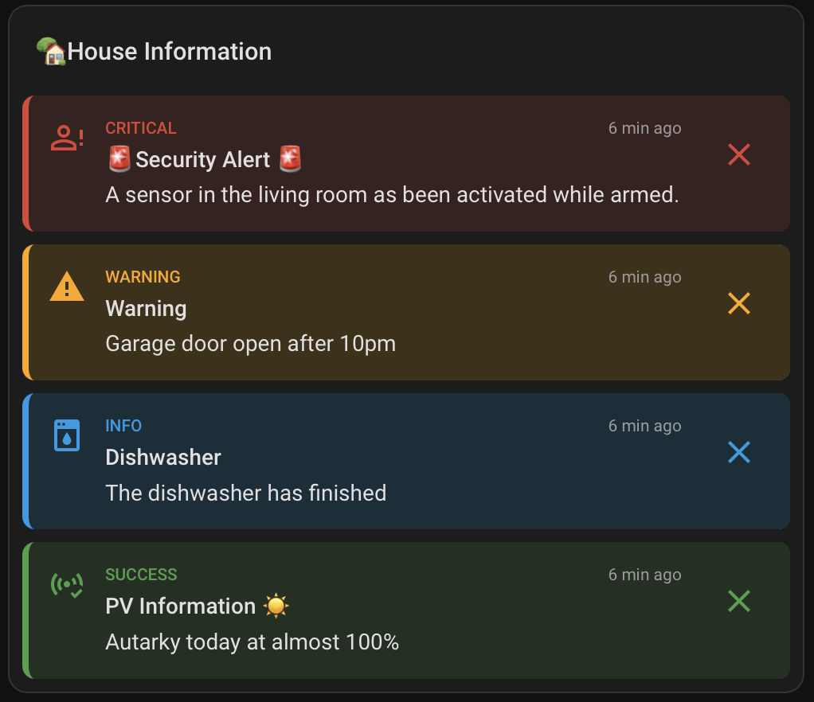

# Heads Up

[](https://my.home-assistant.io/redirect/hacs_repository/?owner=Seyphaton&repository=ha-heads-up&category=integration)
[](https://my.home-assistant.io/redirect/config_flow_start/?domain=heads_up)

Heads Up is a notification hub for Home Assistant. An automation says what happened; Heads Up chooses who is told, on which channel and how loudly, and removes the message from every channel when it ends.

## Problems it solves

- Every automation and script hard-codes phones, speakers and quiet-hour templates. Replacing a phone means editing thirty automations.
- Dashboard banners differ from setup to setup. Heads Up has one banner with a timeout, a condition, a closed state per person and a snooze.
- A critical alert looks like any other message. Heads Up can open it as a window over any dashboard.
- A critical alert that nobody read stays unread. An escalation notifies more people or channels after a delay, until someone acknowledges it.
- A message is sent once and forgotten. A reminder repeats it while nobody acknowledges it.
- A message closed on the phone is still on the wall tablet and is spoken again. When a message is cleared or expires, every channel takes it back. When one person closes it, it is gone for that person.

## What it does

- Banner: a dismissible banner in a dashboard card. It stays until someone closes it, its condition stops matching, its timeout passes or an action clears it, and it survives a restart. Watch rules show a banner while an entity is in a state, without an automation.
- Push, popup, speech and the notification bell: one message can reach Companion app notifications, a window over any dashboard, speakers and Assist satellites, and Home Assistant's notification bell. The action `heads_up.notify` names the channels. Each channel also has its own action.
- Audiences: Everyone, Admins, At home, Not home, Last to leave, First home, persons, a zone, or a speaker group. Phones are found from the person, so replacing a phone is one change.
- Policies: Escalation, Reminder, Quiet hours, Away, Fallback, Summarize and Deliver. They are kept apart from the automations. The panel's welcome offers four defaults: quiet hours, an evening summary, critical messages and warning reminders.
- Acknowledgement: it stops escalations and reminders, and the card shows who acknowledged.
- Explanation: the panel previews who a call would reach right now, and why anyone is skipped, held or dropped. Each message has a trace.
- Rate limits: 5 pushes per device per minute and 60 in total. Critical messages are never held back.
- Panel: an administrator page in the sidebar. See [Panel](docs/panel.md).

Banners, rules and the card work without any hub object. You can switch the hub off in the settings.

Start with [How to use Heads Up](docs/how-to.md). The terms are in [Notification hub](docs/hub.md).

Everything was tested on local Home Assistant instances with stub devices, not on real phones or speakers. Make a backup before you install.

## Requirements

- Home Assistant 2026.9.0 or newer.
- Tested on 2026.10.4 (tests and a local instance) and 2026.9.4 (tests).

## Install

Make a backup first. Installing needs a Home Assistant restart, which pauses all automations until it has finished.

### With HACS

The first button at the top opens the repository in HACS on your Home Assistant. The second opens the setup dialog of the integration after it is installed.

Heads Up is not in the default HACS list. Add it as a custom repository:

1. In HACS, click the three dots in the top right corner and choose "Custom repositories".
2. Enter `https://github.com/Seyphaton/ha-heads-up` and select the type "Integration".
3. Click "Add", then find Heads Up in HACS and download it.
4. Restart Home Assistant.

### By hand

1. Copy the folder `custom_components/heads_up` of this repository to `custom_components/heads_up` in your Home Assistant configuration folder.
2. Restart Home Assistant.

## Set up

Go to Settings > Devices & services and add the integration Heads Up. It asks whether to show Heads Up in the sidebar. The integration registers the card, so you add no dashboard resource. Open the panel to see the welcome.

## Quick start

Add the card to a dashboard in the YAML editor:

```yaml
type: custom:heads-up-card
title: House Information
show_time: true
show_severity: true
```

Create a banner in Developer tools > Actions (YAML mode), or from an automation or script:

```yaml
action: heads_up.create_banner
data:
  id: garage_open
  title: Warning
  message: Garage door open after 10pm.
  severity: warning
```

The banner appears in the card without a reload. Close it with the X button, or remove it with `heads_up.clear_all`. Without `timeout` it disappears after 24 hours.



Send one message to the banner, the phones of everyone and the notification bell:

```yaml
action: heads_up.notify
data:
  message: Water leak
  severity: critical
  channels: [banner, push, persistent]
  to:
    push: {audience: Everyone}
```

The card receives banners over the Home Assistant WebSocket connection and does not poll. The integration creates one entity, `sensor.heads_up_active_banners`, with the number of active banners, including active watch-rule banners.

## Documentation

- [How to use Heads Up](docs/how-to.md): options with examples and screenshots.
- [Notification hub](docs/hub.md): the terms, and examples from a household.
- [Panel](docs/panel.md), [Policies](docs/policies.md), [Audiences and recipients](docs/audiences.md)
- Channels: [Push](docs/push.md), [Popup](docs/popup.md), [Speech](docs/speech.md), [Notification bell](docs/persistent.md)
- [Actions](docs/actions.md): fields, responses, conditions, people, events.
- [Card](docs/card.md): options and behaviour.
- [Watch rules](docs/rules.md): banners from an entity state or value, without an automation.
- [Examples](docs/examples.md): window with a condition, alert for one person, tap action, REST and WebSocket.
- [Troubleshooting](docs/troubleshooting.md)
- [Limitations](docs/limitations.md)
- [Upgrading](docs/upgrading.md) and [uninstalling](docs/uninstall.md)
- [Security](SECURITY.md)

## License

MIT, see [LICENSE](LICENSE).
