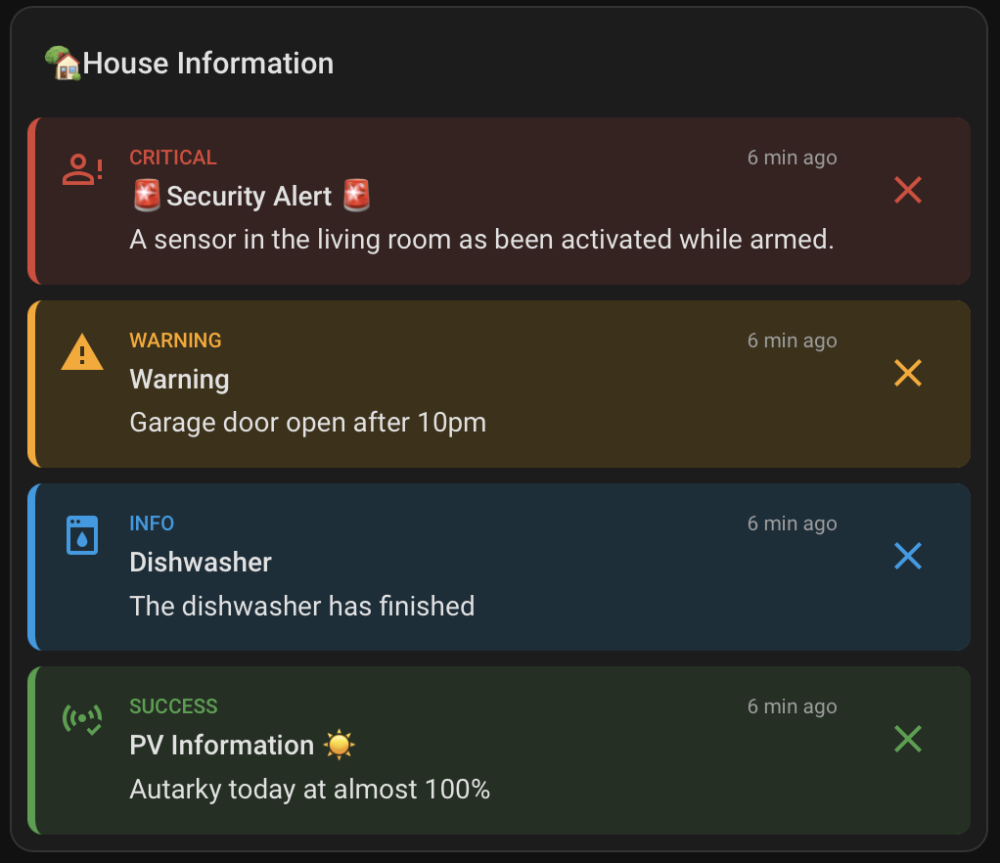
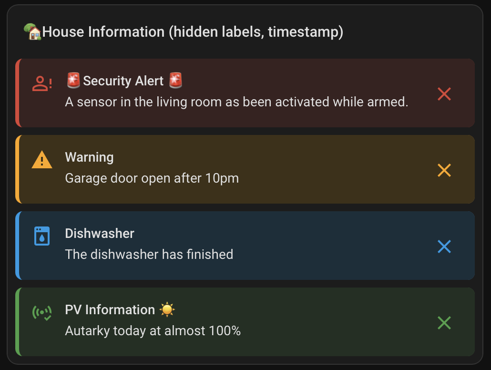
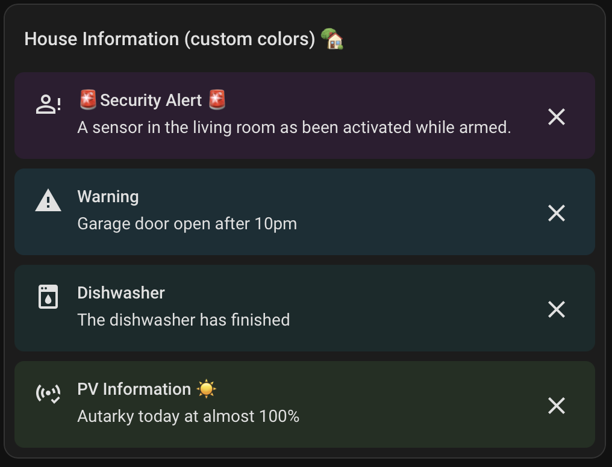
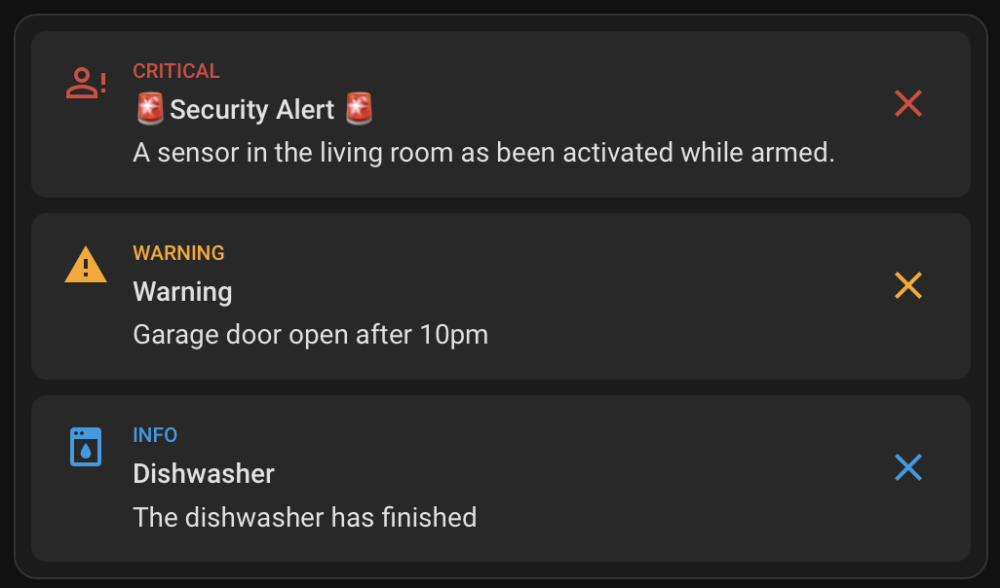
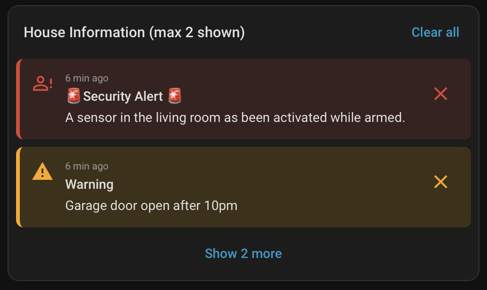
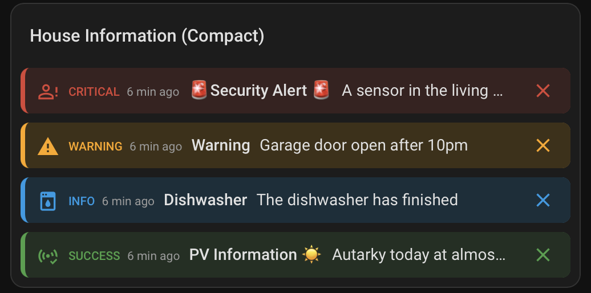
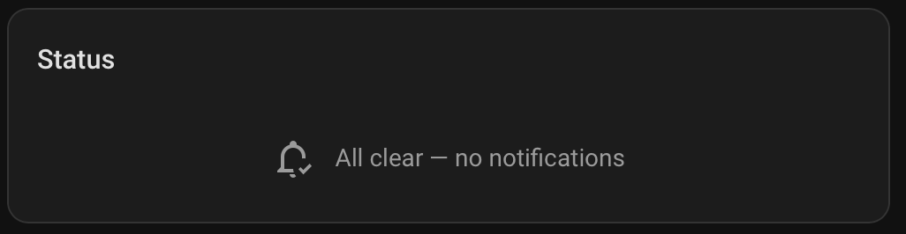
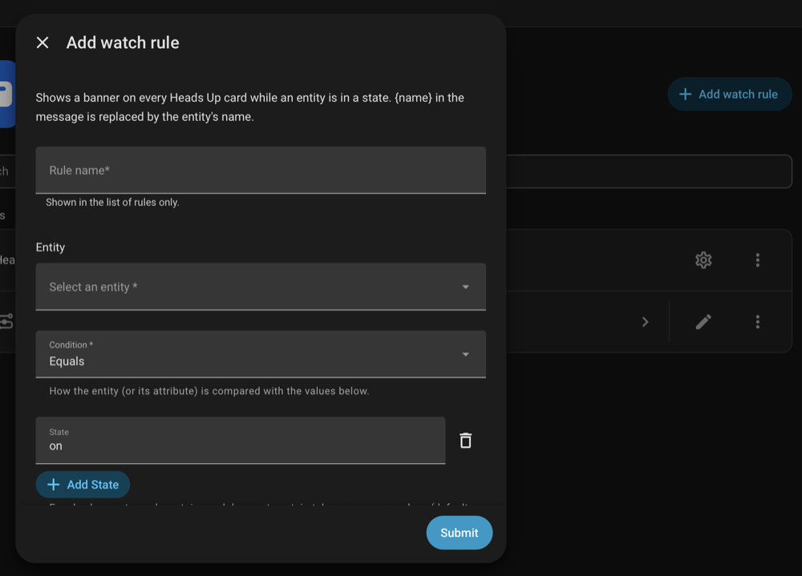

# Heads Up

[](https://my.home-assistant.io/redirect/hacs_repository/?owner=Seyphaton&repository=ha-heads-up&category=integration)
[](https://my.home-assistant.io/redirect/config_flow_start/?domain=heads_up)

Heads Up shows banners inside a Home Assistant dashboard. Automations, scripts and external programs create and clear banners with actions. Watch rules show a banner while an entity is in a state, without an automation. The dashboard holds no message text.

Banners stay until someone closes them, a condition on an entity stops matching, a timeout passes, or an action clears them. They survive a Home Assistant restart.

Status: version 0.2.1. It was tested on a local development instance of Home Assistant only. Make a backup before you install it.

## Requirements

- Home Assistant 2026.9.0 or newer.
- Tested on Home Assistant 2026.9.4 (tests and a local instance) and 2026.10.4 (tests only).

## Install

Make a backup first. Installing needs a Home Assistant restart, which pauses all automations until it has finished.

### With HACS

The first button at the top opens the repository in HACS on your Home Assistant. It works once the repository is public. The second button opens the setup dialog of the integration after it is installed.

Heads Up is not in the default HACS list. Add it as a custom repository:

1. In HACS, click the three dots in the top right corner and choose "Custom repositories".
2. Enter `https://github.com/Seyphaton/ha-heads-up` and select the type "Integration".
3. Click "Add", then find Heads Up in HACS and download it.
4. Restart Home Assistant.

### By hand

1. Copy the folder `custom_components/heads_up` of this repository to `custom_components/heads_up` in your Home Assistant configuration folder.
2. Restart Home Assistant.

## Set up

Go to Settings > Devices & services and add the integration Heads Up. It asks for nothing. The card is registered by the integration, so you do not add a dashboard resource.

Banners also come from watch rules: a rule shows a banner while an entity matches a condition. See [section 3](#3-watch-rules) and [docs/rules.md](docs/rules.md).

## 1. Configure the dashboard card

Add the card to a dashboard in the YAML editor. Without options it shows every banner, most severe first:

```yaml
type: custom:heads-up-card
title: House Information
show_time: true
show_severity: true
```



All options are in [docs/card.md](docs/card.md). The card also has a visual editor. These variants change one thing each.

**Without severity label and time.** This is the default. The icon and color show the severity.

```yaml
type: custom:heads-up-card
title: House Information
```



**Custom colors.** `colors` sets a color per severity. `colorize: background` colors only the banner background.

```yaml
type: custom:heads-up-card
title: House Information (custom colors)
colorize: background
colors:
  critical: "#2d1f33"
  warning: "#1d2d33"
  info: "#1c2b2b"
  success: "#243021"
```



**Only the icon colored.** `colorize: icon` leaves the background neutral. `max_items: 3` hides the fourth banner.

```yaml
type: custom:heads-up-card
colorize: icon
show_severity: true
max_items: 3
```



**Collapsed list.** `collapsed_items: 2` shows two banners and a "Show 2 more" button. `clear_all` adds a "Clear all" button that dismisses the banners for you only.

```yaml
type: custom:heads-up-card
title: House Information (max 2 shown)
show_time: true
collapsed_items: 2
clear_all: true
```



**Compact.** `layout: compact` puts each banner on one line and cuts long text with "…".

```yaml
type: custom:heads-up-card
title: House Information (Compact)
layout: compact
show_time: true
show_severity: true
```



**Empty.** With `empty_message` the card stays visible when there are no banners. Without it, the card hides itself.

```yaml
type: custom:heads-up-card
title: Status
empty_message: All clear — no notifications
```



## 2. Example calls

Run these in Developer tools > Actions (YAML mode) or put them in an automation or script. The banner appears in the card without a reload. Close it with the X button, or remove it with `heads_up.clear_all`. The calls below produce the banners in the first screenshot.

**Critical.** Sorts first and is never removed to make room for new banners. `timeout: 0` keeps it until someone closes it.

```yaml
action: heads_up.create_banner
data:
  id: security_alert
  title: Security Alert
  message: A sensor in the living room has been activated while armed.
  severity: critical
  icon: mdi:account-alert-outline
  timeout: 0
```

**Warning.** The default severity. Without `timeout`, the banner disappears after 24 hours.

```yaml
action: heads_up.create_banner
data:
  id: garage_open
  title: Warning
  message: Garage door open after 10pm.
  severity: warning
```

**Info.** The icon replaces the default one. The banner disappears after 30 minutes.

```yaml
action: heads_up.create_banner
data:
  title: Dishwasher
  message: The dishwasher has finished.
  severity: info
  icon: mdi:dishwasher
  timeout:
    minutes: 30
```

**Success.** Calling this again with the same `id` replaces the banner instead of adding a second one.

```yaml
action: heads_up.create_banner
data:
  id: pv_status
  title: PV Information
  message: Autarky today at almost 100%.
  severity: success
```

**Tied to an entity.** The banner shows while the entity is `on` and is removed the first time it stops matching.

```yaml
action: heads_up.create_banner
data:
  id: window_bedroom
  message: The bedroom window is open.
  timeout: 0
  condition:
    entity_id: binary_sensor.bedroom_window
    state: "on"
```

**For one person, not closable.** Only the user linked to the person sees it. Nobody can close it. Remove it with `clear_banner`.

```yaml
action: heads_up.create_banner
data:
  id: water_leak
  title: Water leak
  message: Water detected in the basement.
  severity: critical
  dismissible: false
  people:
    - person.alex
```

```yaml
action: heads_up.clear_banner
data:
  id: water_leak
```

**With a tap action.** Tapping the banner opens a dashboard view.

```yaml
action: heads_up.create_banner
data:
  message: Water detected under the dishwasher.
  severity: critical
  tap_action:
    action: navigate
    navigation_path: /lovelace/kitchen
```

More examples, including REST and WebSocket calls, are in [docs/examples.md](docs/examples.md).

## 3. Watch rules

A watch rule shows a banner while an entity matches a condition. It needs no automation and no card setting. Go to Settings > Devices & services > Heads Up and choose "Add watch rule".



Examples, as filled into the form. `{name}` in the message becomes the entity's name.

| Goal | Entity | Condition | State | Message | Severity |
|---|---|---|---|---|---|
| Window open | `binary_sensor.bedroom_window` | Equals | `on` | `{name} is open.` | warning |
| Door not locked | `lock.front_door` | Does not equal | `locked` | `{name} is not locked.` | critical |
| Room too warm | `sensor.living_room_temperature` | Above | `25` | `The living room is warmer than 25 °C.` | info |
| Battery low | `sensor.phone_battery` | Between | `5` and `15` | `The phone battery is low.` | warning |

Conditions: equals, does not equal, above, below, between, contains text, does not contain text. A rule banner has no close button unless you turn on "Dismissible", and it goes away when the condition is false. The same conditions work in `heads_up.create_banner` through `condition.operator`. See [docs/rules.md](docs/rules.md) for every field and more examples.

## Options

Open the integration and choose Configure. Changes apply to banners created afterwards.

| Option | Default | Meaning |
|---|---|---|
| Maximum number of banners | 50 (1–200) | Limit for stored banners. |
| Evict the oldest lowest-severity banner when full | on | When off, creating a banner beyond the limit fails. `critical` banners are never evicted. |
| Default dismiss scope | `user` | Used when an action sets no `dismiss_scope`. |
| Default timeout | 24 hours | Used when an action sets no `timeout`. Clearing it keeps banners until they are closed or cleared. |

## How it works

The card receives banners over the Home Assistant WebSocket connection and updates when a banner changes. It does not poll. The integration creates one entity, `sensor.heads_up_active_banners`, with the number of active banners, including active watch-rule banners.

## Documentation

- [Actions](docs/actions.md): fields, responses, conditions, people, events.
- [Card](docs/card.md): options and behaviour.
- [Watch rules](docs/rules.md): banners from an entity state or value, without an automation.
- [Examples](docs/examples.md): window with a condition, alert for one person, tap action, REST and WebSocket.
- [Troubleshooting](docs/troubleshooting.md)
- [Limitations](docs/limitations.md)
- [Upgrading](docs/upgrading.md) and [uninstalling](docs/uninstall.md)
- [Security](SECURITY.md)

## License

MIT, see [LICENSE](LICENSE).
