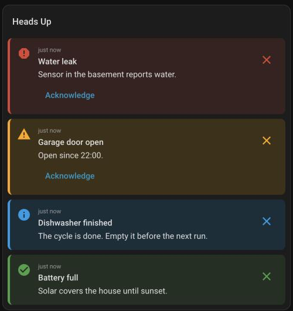
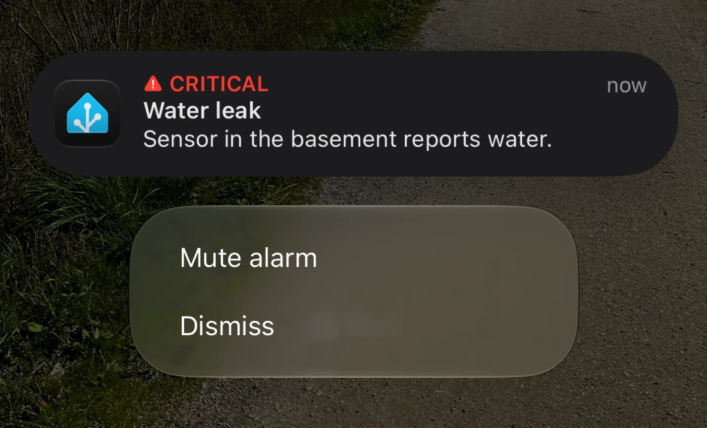
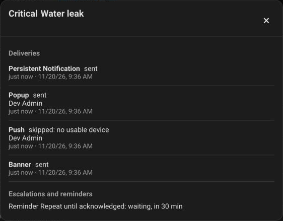
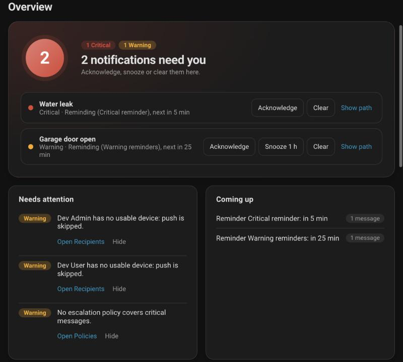

# Heads Up

[](https://my.home-assistant.io/redirect/hacs_repository/?owner=Seyphaton&repository=ha-heads-up&category=integration)
[](https://my.home-assistant.io/redirect/config_flow_start/?domain=heads_up)

Heads Up is a central notification hub for Home Assistant. It gives your automations one way in to every channel: the dashboard, phones, popups, speakers, mail and persistent notifications. Audiences can follow who is home, who left a zone or who arrived first, and policies add reminders, escalation, quiet hours and an evening summary.

The channel it adds to Home Assistant is the banner. A banner sits in a dashboard card until someone dismisses it, its condition stops matching or its timeout passes. When a message ends, Heads Up takes it back from every channel that can be cleared: the banner, the pushes, the popup and the persistent notification.


<p> </p>

One `heads_up.notify` call, on the dashboard card and on a phone.

## What it takes out of your automations

### Channels

A message lists its channels: `channels: [banner, push, popup]`. Send it again with the same `id` and it is replaced on each of them, so a phone keeps a single notification for it. `heads_up.clear_notifications` removes the banner, the pushes, the popup and the Persistent Notification in one step. Speech and mail cannot be taken back.

Each message has one of four severities: critical, warning, info or passive. The panel's Severities page sets the label, icon, color, push level and popup style of each one for every card, popup and phone.


### Audiences

A call names people. Heads Up finds each person's phones through their trackers, so a new phone needs no change in any automation.

The built-in audiences are Everyone, Admins, At home, Not home, Last to leave and First home. They are worked out when the message goes out. Last to leave is the person whose departure emptied the house: the push about the open back door goes to whoever just walked out of it, and nobody else. You can add your own, such as one person while at home, or everyone in a zone.

Where a person is comes from Home Assistant. For any zone you can choose an input boolean or binary sensor instead, for example a template sensor that also checks the alarm.

### Policies

A policy describes behaviour once and applies to every message with a matching severity and tag. Escalate to more people when nobody reacts. Repeat until someone acknowledges. Keep pushes quiet from 22:00 to 07:00, or while a schedule is on. Hold a push until the person arrives home or leaves a zone, or collect messages tagged `digest` into one summary at 20:00.

The leak automation then only says "critical, tag `water`". If nobody acknowledges within five minutes, an escalation policy has the speakers say it and pushes it to the administrators. The automation itself has no loop, no wait and no presence check. The [leak example](https://github.com/Seyphaton/ha-heads-up/blob/main/docs/examples.md#a-leak-that-escalates) lists the policies.

### Keeping track

Acknowledging a message on a phone, the card or a popup stops its escalations and reminders for everyone. A Fallback policy sends a message somewhere else when it reached nobody, for example because nobody was home or the push failed.

When something did not arrive, the Message Log tells you why. It lists each channel with the people and phones it reached and a reason for every skipped delivery, such as "push to Anna skipped: quiet hours".



## Get started in the UI

1. In HACS, search for "Heads Up", click Download and restart Home Assistant. It needs Home Assistant 2026.9.0 or newer. Make a backup first.
2. Go to Settings > Devices & services > Add integration > Heads Up. Leave "Show Heads Up in the sidebar" on: it adds the panel, visible to administrators.
3. Open Heads Up in the sidebar. The Overview starts with a four-step introduction: what Heads Up does, the channels, the audiences with the people in them now, and four default policies. The default policies are critical messages pushed at once to the administrators, warnings repeated every 30 minutes up to three times, an evening summary and quiet hours at night. Policies are created only in the last step, and Not now creates none.

   

4. Open Test & Logs > Test send. Pick channels and an audience, and the table shows who would get the message on which channel, or why not. Send test sends one real message, which ends by itself after 10 minutes.

5. Add the card to a dashboard of your own (the built-in Overview cannot be edited): Edit, Add card, then search for Heads Up.
6. In an automation, add the action Heads Up: Notify and fill in the form. For a banner that shows while an entity is in a state, with no automation at all, add a watch rule under Banner watch rules.

## The same in YAML

The call from step 6, for a banner and a push to everyone. A push needs the Companion app on a phone that belongs to a person.

```yaml
action: heads_up.notify
data:
  id: front_door
  title: Front door
  message: The front door has been open for 10 minutes.
  severity: warning
  channels: [banner, push]
  audience: binary_sensor.heads_up_audience_everyone
```

Take it back from every channel when the door closes:

```yaml
action: heads_up.clear_notifications
data:
  id: front_door
```

To try a call by hand, use Developer tools > Actions (named Tools in Home Assistant 2026.10) in YAML mode. If nothing arrives, open Test & Logs > Message Log and select the message.

## Documentation

- [Setup guide](https://github.com/Seyphaton/ha-heads-up/blob/main/docs/setup.md): install, first message, card, panel, introduction, upgrading, uninstalling.
- [Actions, watch rules and card](https://github.com/Seyphaton/ha-heads-up/blob/main/docs/actions.md): every action field, watch rules and the card options.
- [Configuration](https://github.com/Seyphaton/ha-heads-up/blob/main/docs/configuration.md): channels, audiences, recipients and policies.
- [Settings](https://github.com/Seyphaton/ha-heads-up/blob/main/docs/settings.md): every setting and global default, with its limits.
- [Examples and FAQ](https://github.com/Seyphaton/ha-heads-up/blob/main/docs/examples.md): working examples, common questions, troubleshooting and limitations.
- [Security](https://github.com/Seyphaton/ha-heads-up/blob/main/SECURITY.md) and [Changelog](https://github.com/Seyphaton/ha-heads-up/blob/main/CHANGELOG.md).

## License

MIT, see [LICENSE](https://github.com/Seyphaton/ha-heads-up/blob/main/LICENSE).
