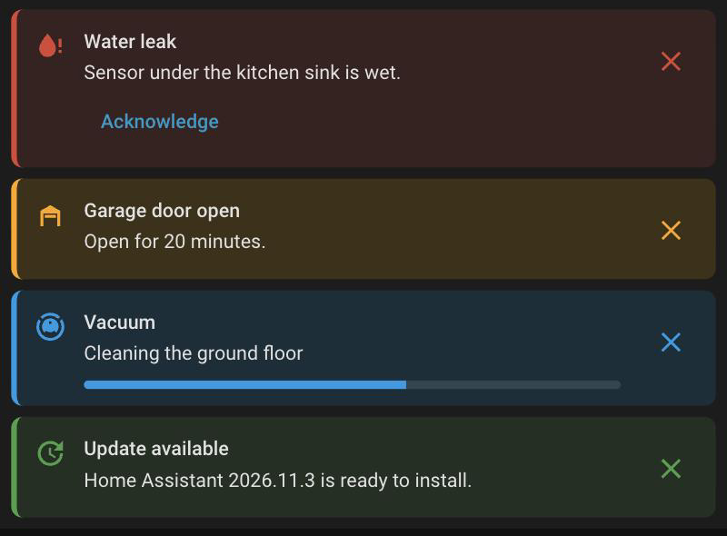
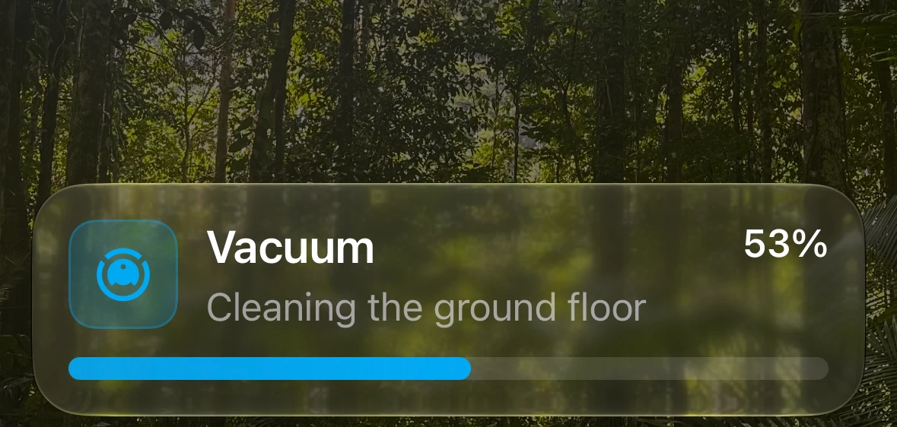
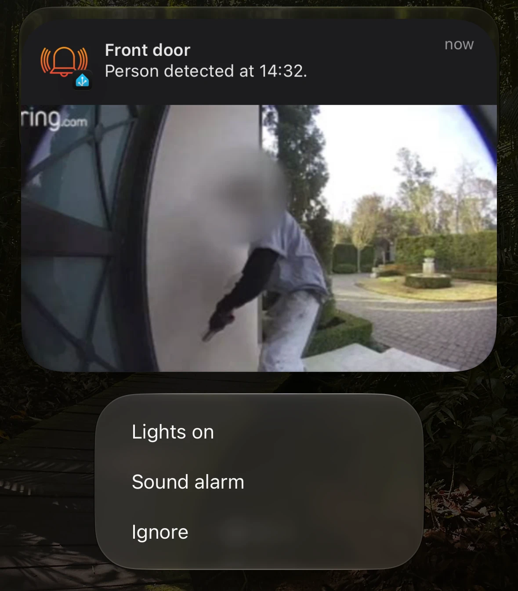
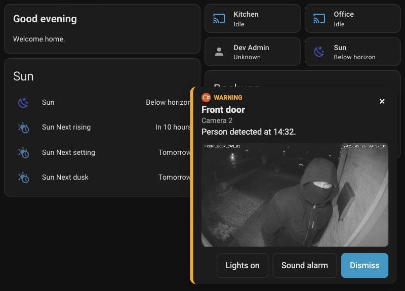
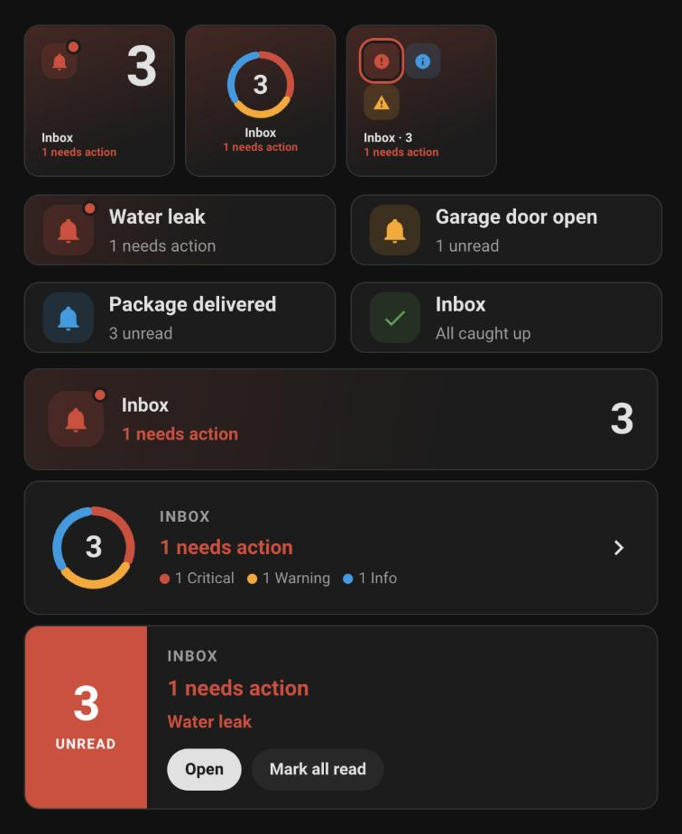
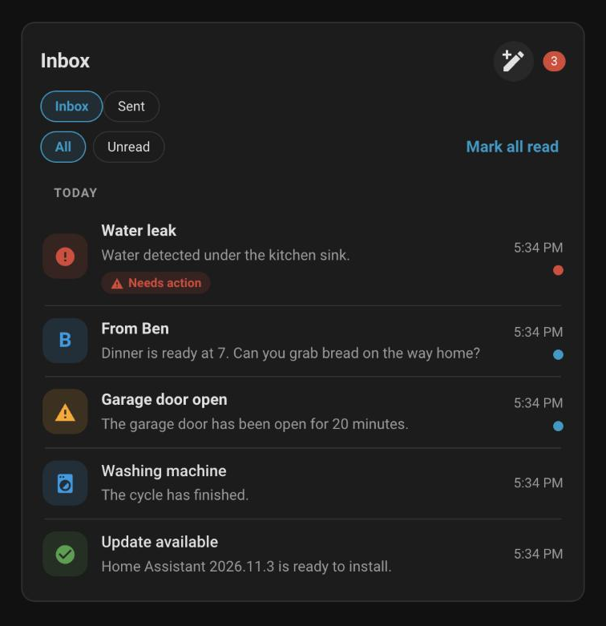
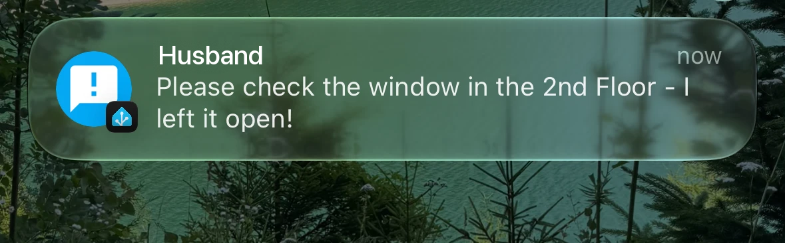
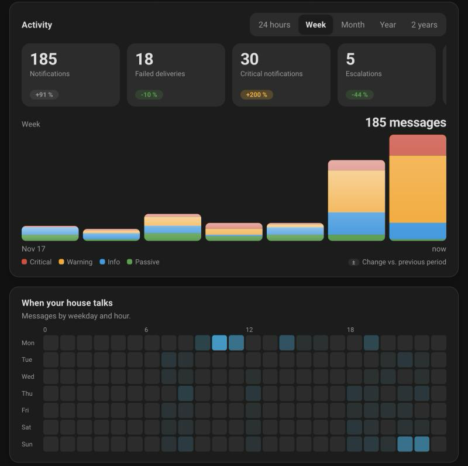
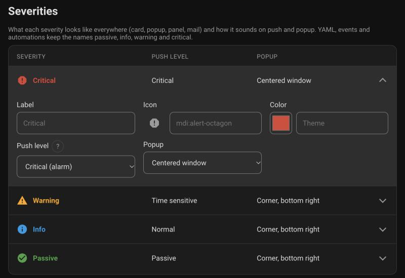

# Heads Up

[](https://my.home-assistant.io/redirect/hacs_repository/?owner=Seyphaton&repository=ha-heads-up&category=integration)
[](https://my.home-assistant.io/redirect/config_flow_start/?domain=heads_up)

Heads Up is the notification hub for Home Assistant. Your automation makes one call, and Heads Up decides where the message shows up, who gets it and what happens next.

<p> </p>

1. **One call, every channel.** A single `heads_up.notify` reaches phones, dashboard banners, popups, speakers, mail and persistent notifications. Your automation never touches a device or a notify service.
2. **Notify people, not devices.** Name a person and Heads Up finds their phones. Swap a phone and no automation changes.
3. **Smart audiences.** Admins only, At home, Last to leave, First home. The open back door goes only to whoever just walked out of it.
4. **Full lifecycle through policies.** Quiet hours, evening digests, repeat until acknowledged, escalate when nobody reacts, hold until someone arrives. Defined once, so your automations carry no loops, waits or presence checks.
5. **Acknowledge once, resolved everywhere.** Dismiss it on one phone and reminders and escalations stop for everyone. When a message ends, it is withdrawn from every channel.
6. **New Dashboard Banners.** You can now show notifications via banners on each dashboard directly, fully linked to all other channels, including button, live activity and picture support.
7. **One look, every platform.** Live activities, severities, icons, colors, buttons and pictures are set once and applied the same on push, banner and popup, on Android and iOS.
8. **A personal inbox.** Each person gets a list that survives restarts, with an unread count, a sensor per person and a card in four sizes. With one more setting the inbox also holds a copy of every notification, whatever the channel.
9. **Messages between people.** People write short messages to each other from the inbox card. The recipient's profile and your policies still decide what is delivered, and the sender never learns whether a message was read.

<p> </p>

<p>  </p>


## What only Heads Up does

- It adds the banner, a channel Home Assistant does not have. A banner stays in a dashboard card until someone dismisses it, its condition stops matching or its timeout passes.
- It gives each message one lifecycle. Send the same `id` again and the message is replaced on every channel, so a phone keeps a single notification. One acknowledgement, on any channel, stops the reminders for everyone.
- It follows people. Last to leave is the person whose departure emptied the house, and a push about the open back door goes to them and nobody else.
- It keeps the logic out of your automations. A leak automation says "critical, tag `water`". Policies repeat it, and after five minutes without an acknowledgement have the speakers say it and push it to the administrators. See the [leak example](https://github.com/Seyphaton/ha-heads-up/blob/main/docs/examples.md#a-leak-that-escalates).
- It tells you what happened. The Message Log lists each channel with the people and phones reached and a reason for every skipped delivery, such as "push to Anna skipped: quiet hours".

## Get started in the UI

1. In HACS, search for "Heads Up", click Download and restart Home Assistant. It needs Home Assistant 2026.9.0 or newer. Make a backup first.
2. Go to Settings > Devices & services > Add integration > Heads Up. Leave "Show Heads Up in the sidebar" on: it adds the panel, visible to administrators.
3. Open Heads Up in the sidebar. The Overview starts with a four-step introduction: what Heads Up does, the channels, the audiences with the people in them now, and four default policies. The default policies are critical messages pushed at once to the administrators, warnings repeated every 30 minutes up to three times, an evening summary and quiet hours at night. Policies are created only in the last step, and Not now creates none.

   

4. Open Test & Logs > Test send. Pick channels and an audience, and the table shows who would get the message on which channel, or why not. Send test sends one real message, which ends by itself after 10 minutes.
5. Add the card to a dashboard of your own (the built-in Overview cannot be edited): Edit, Add card, then search for Heads Up.
6. In an automation, add the action Heads Up: Notify and fill in the form. For a banner that shows while an entity is in a state, with no automation at all, add a watch rule under Banner watch rules.

## The same in YAML

The call from step 6, for a banner and a push to everyone. A push needs the Companion app on a phone that belongs to a person.

```yaml
action: heads_up.notify
data:
  id: front_door
  title: Front door
  message: The front door has been open for 10 minutes.
  severity: warning
  channels: [banner, push]
  audience: binary_sensor.heads_up_audience_everyone
```

Take it back from every channel when the door closes:

```yaml
action: heads_up.clear_notifications
data:
  id: front_door
```

To try a call by hand, use Developer tools > Actions (named Tools in Home Assistant 2026.10) in YAML mode. If nothing arrives, open Test & Logs > Message Log and select the message.

## Glossary

- **Channels:** Where a message shows up: `banner`, `push`, `popup`, `speak`, `mail`, `persistent` and `inbox`. A message lists its channels, for example `channels: [banner, push, popup]`. `heads_up.clear_notifications` removes the banner, the pushes, the popup and the Persistent Notification. Speech and mail cannot be taken back. An inbox item stays and is marked as ended.
- **Banner:** A message in the Heads Up card on a dashboard. It stays until a person dismisses it, its condition stops matching or its timeout passes. It can carry up to 3 buttons, a picture, a snooze and a progress bar.
- **Severity:** One of critical, warning, info or passive. The panel's Severities page sets the label, icon, color, push level and popup style of each one for every card, popup and phone.



- **Audience:** Who gets a message. A call names people, and Heads Up finds each person's phones through their trackers. The built-in audiences are Everyone, Admins, At home, Not home, Last to leave and First home, worked out when the message goes out. You can add your own, such as one person while at home, or everyone in a zone.
- **Presence:** Where a person is comes from Home Assistant. For any zone you can choose an input boolean or binary sensor instead, for example a template sensor that also checks the alarm.
- **Policy:** Behaviour described once for every message with a matching severity and tag. A policy can escalate to more people when nobody reacts, repeat until someone acknowledges, keep pushes quiet from 22:00 to 07:00 or while a schedule is on, hold a push until the person arrives home or leaves a zone, or collect messages tagged `digest` into one summary at 20:00.
- **Fallback:** A policy that sends a message somewhere else when it reached nobody, for example because nobody was home or the push failed.
- **Acknowledge, dismiss and snooze:** Acknowledging a message on a phone, the card or a popup stops its escalations and reminders for everyone. Dismissing hides it for one person or for everyone, as the message says. Snoozing hides it for a set time.
- **Watch rule:** A banner that shows while an entity is in a state, with no automation. It leaves when the state ends.
- **Overview:** The panel's first page. It shows what needs you now, what is about to happen and what happened last, and a table that runs a test message through your policies. Its Activity cards count messages, failed deliveries, critical messages, escalations and how often quiet hours and summaries took over, with the change against the period before, for up to two years. They store counts only.
- **Inbox:** A list of messages for one person, kept across restarts. The inbox card shows the inbox of the user who is looking, and `sensor.heads_up_inbox_<person>` counts the unread items. A message gets there with the channel `inbox`.
- **Message between people:** A short text one person sends to others from the inbox card. It goes to the inbox and, if the sender picks them, to push, popup and mail. An administrator switches the feature on; it is off by default.
- **Message Log:** The trace of each message under Test & Logs. When something did not arrive, it tells you why.

## Documentation

- [Setup guide](https://github.com/Seyphaton/ha-heads-up/blob/main/docs/setup.md): install, first message, card, panel, introduction, upgrading, uninstalling.
- [Actions, watch rules and card](https://github.com/Seyphaton/ha-heads-up/blob/main/docs/actions.md): every action field, watch rules and the card options.
- [Configuration](https://github.com/Seyphaton/ha-heads-up/blob/main/docs/configuration.md): channels, audiences, recipients and policies.
- [Settings](https://github.com/Seyphaton/ha-heads-up/blob/main/docs/settings.md): every setting and global default, with its limits.
- [Inbox and messages between people](https://github.com/Seyphaton/ha-heads-up/blob/main/docs/configuration.md#inbox): the inbox channel, the card and its sizes, messages between people.
- [Examples and FAQ](https://github.com/Seyphaton/ha-heads-up/blob/main/docs/examples.md): working examples, common questions, troubleshooting and limitations.
- [Security](https://github.com/Seyphaton/ha-heads-up/blob/main/SECURITY.md) and [Changelog](https://github.com/Seyphaton/ha-heads-up/blob/main/CHANGELOG.md).

## License

MIT, see [LICENSE](https://github.com/Seyphaton/ha-heads-up/blob/main/LICENSE).
