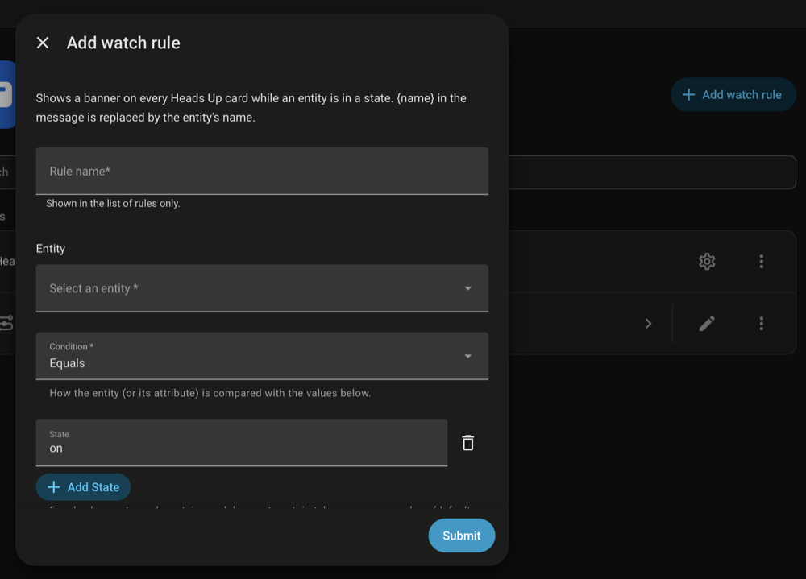
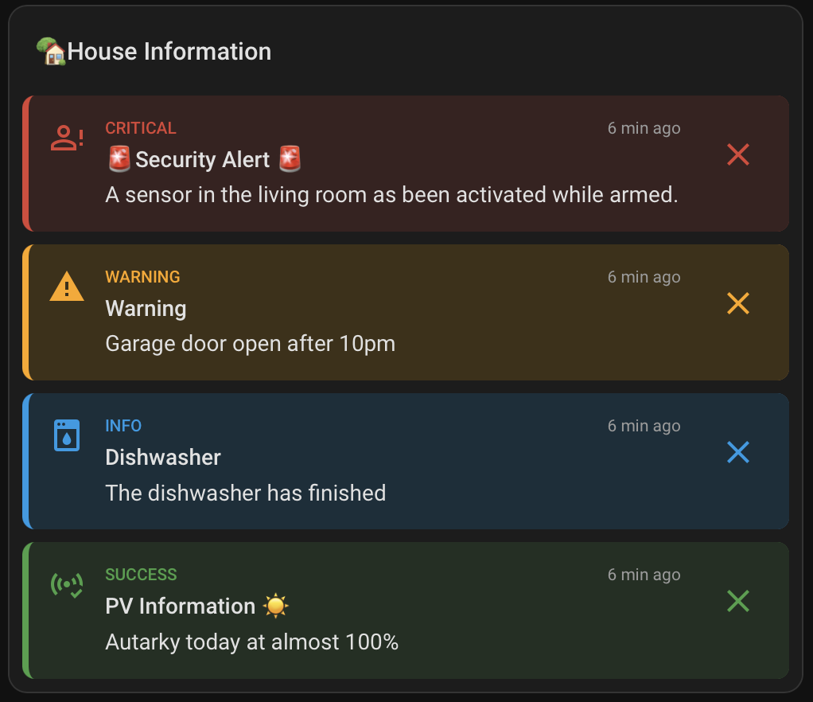
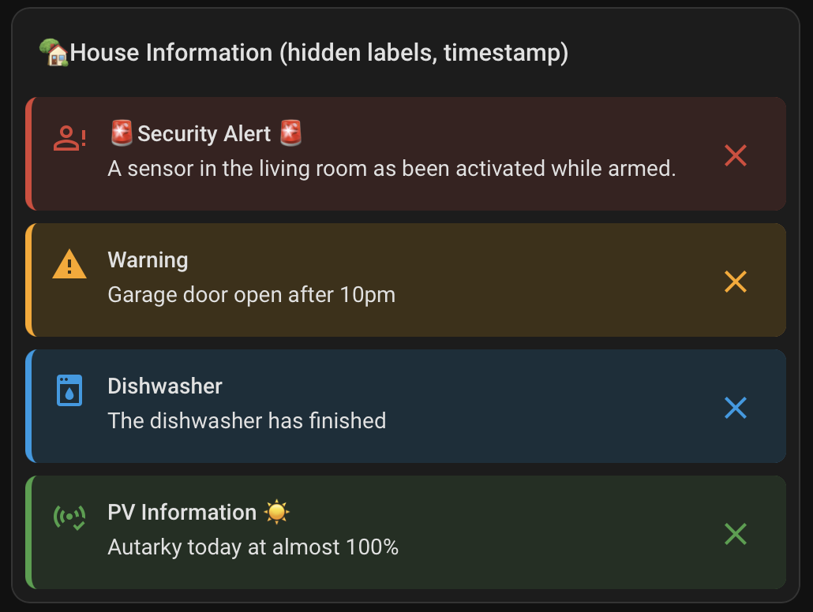
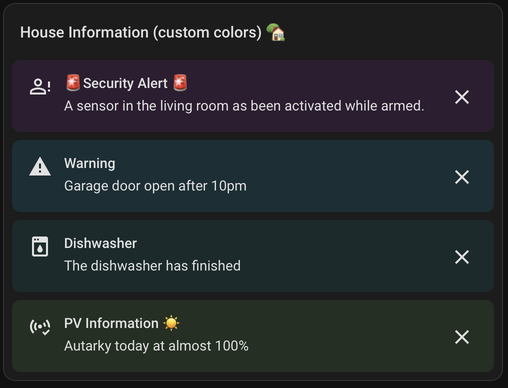
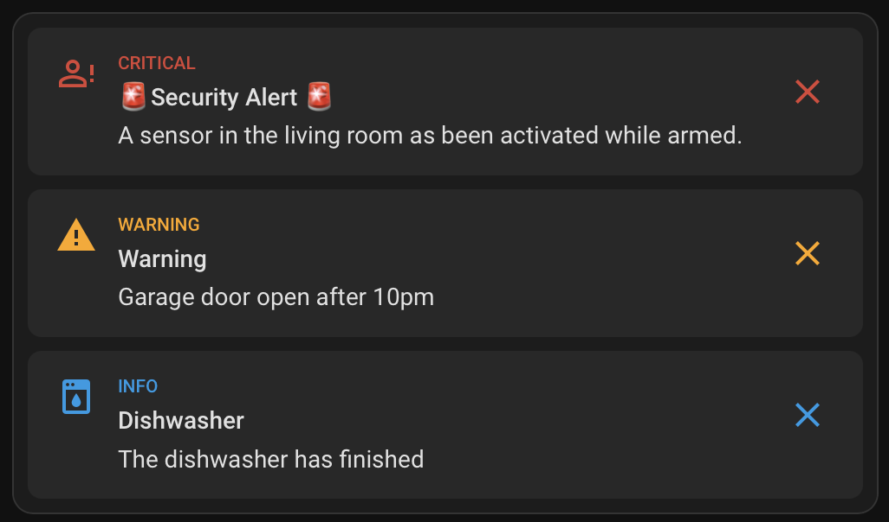
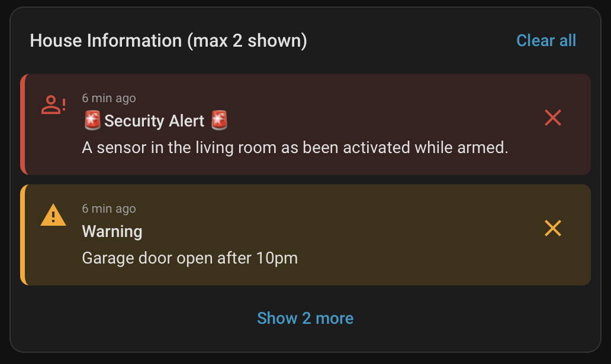
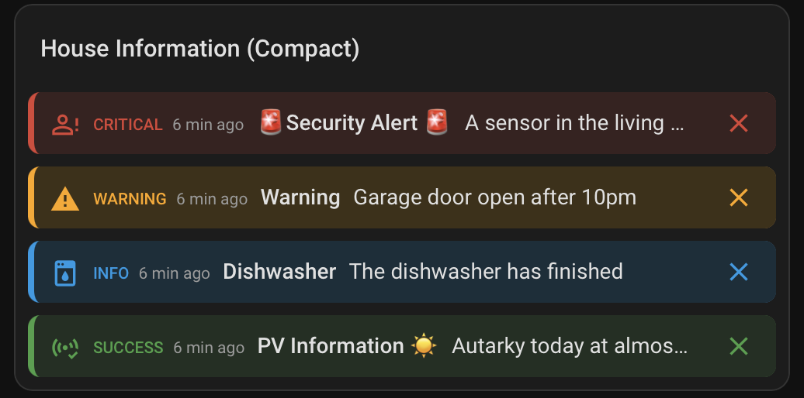
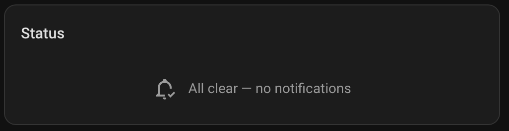
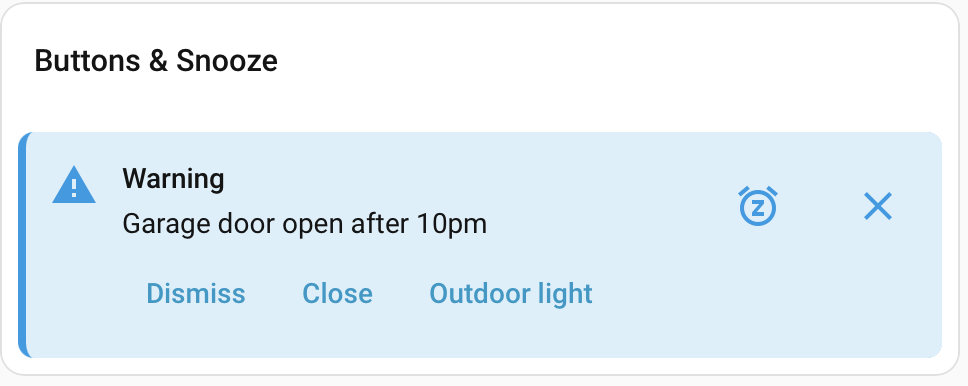

# Actions, watch rules and card

Heads Up has one main action, `heads_up.notify`. It sends one message to the channels you name. The other actions are shortcuts for common cases and the actions that take a message back. Call them from automations, scripts, blueprints or Developer tools > Actions (named Tools in Home Assistant 2026.10). Watch rules and the card follow the actions.

| You want to | Use |
|---|---|
| Send a message to one or more channels (banner, push, popup, speech, mail, bell) | [`heads_up.notify`](#heads_upnotify) |
| Show a banner on the dashboard and nothing else | [`heads_up.create_banner`](#heads_upcreate_banner), the same as `notify` with `channels: [banner]` |
| Send a push, a popup or speech and nothing else | [`heads_up.push`](#heads_uppush), [`heads_up.popup`](#heads_uppopup), [`heads_up.speak`](#heads_upspeak) |
| Take messages back, from every channel or chosen ones | [`heads_up.clear_notifications`](#heads_upclear_notifications) |
| Remove banners only (deprecated) | [`heads_up.clear_banner`](#heads_upclear_banner), [`heads_up.clear_all`](#heads_upclear_all) |
| Show a banner while an entity is in a state, without an automation | [Watch rules](#watch-rules) |
| Show the banners on a dashboard | [The card](#the-card) |

A message is what an action sends, on one or more channels. A banner is the dashboard view of a message, so every field that works for a banner is a field of `notify`. The action texts in Home Assistant say "message" for the thing and "banner" only for the card.

## `heads_up.notify`

Delivers one message on the channels you name. Calling it again with the same `id` replaces the message.

```yaml
action: heads_up.notify
data:
  id: front_door
  title: Front door
  message: The front door has been open for 10 minutes.
  severity: warning
  channels: [banner, push]
  audience: binary_sensor.heads_up_audience_at_home
```

The banner is on the dashboard for the people who are home, and each of them gets a push. When the message ends, both are taken back. Only `message` and `channels` are required.

### What the message says

| Field | Type | Default | Meaning |
|---|---|---|---|
| `message` | text | required | The text, 1–1000 characters. |
| `title` | text | none | A heading above the message, up to 100 characters. |
| `severity` | `success`, `info`, `warning`, `critical` | required | How important the message is. It sets the color, the default icon and the sort order of the banner; the push level (`success` and `info` are passive, `warning` normal, `critical` time-sensitive, shown at once on an idle phone); the popup style; and whether quiet hours let the message pass (`critical` does unless you change it). |
| `icon` | icon, for example `mdi:water-alert` | the icon of the severity | Replaces the default icon on the banner and in the popup. A push, speech, mail and the notification bell do not show it. |
| `image` | text | none | A picture shown under the message on the card, in the popup and on the push: an `http://` or `https://` URL, or a path on this Home Assistant starting with `/` (`/local/door.jpg`, `/media/local/door.jpg`). Up to 2048 characters. Heads Up does not fetch or check it; a wrong path shows no picture. A picture from another host is loaded by the card, the popup and the phone, so that host learns the viewer's address and when the picture is shown. A path on this Home Assistant avoids that. Paths under `/api/` and `/media/` are signed for the card and the popup. The phone loads the picture itself, so it must reach the URL; camera proxy paths (`/api/camera_proxy/...`) work on Android only. The compact card layout shows no picture. With a lock screen setting other than `full`, the push has no picture (`image_hidden` in the trace). |
| `tts_message` | text | the title if set, otherwise the message | The text for the speak channel, when it should differ from the written message. |
| `tap_action` | object with `action` | none | A Home Assistant action that runs when someone taps the banner (the card) or the push. Passed on unchanged. Anyone who sees the banner can trigger it; see [SECURITY.md](../SECURITY.md). |

### Where it goes and who gets it

| Field | Type | Default | Meaning |
|---|---|---|---|
| `channels` | list of channels | required | One or more of `banner`, `push`, `popup`, `speak`, `persistent`, `mail`, each at most once. |
| `dry_run` | boolean | `false` | `true`: nothing is sent, stored or recorded. The response is the plan: what each channel and recipient would get now, with the policies applied. See Response. |
| `match_policies_automatically` | boolean | `true` | `true`: policies that match the severity or tags of the message apply automatically. `false`: only the manual policies in `policy` apply, and none if there is no manual policy. Manual policies always apply. |
| `policy` | list of policy switches | none | Manual policies: they apply next to the automatic policies that match the severity and tag, whatever their own severities and tags say. Name a policy by the entity ID of its switch, for example `switch.heads_up_policy_quiet_hours`. The ID stays when you rename the policy. The policy editor shows it. A policy name as text is refused. A disabled policy is never used. In YAML `policy: none` does the same as `disable_automatic_policies: true` without a manual policy. |
| `recipients` | list of persons | none | Who gets the message on every channel that takes people: banner, push, popup and mail. Give either `recipients` or `audience`. |
| `audience` | audience sensor | none | A group that gets the message on the same channels. Name it by the entity ID of its sensor, for example `binary_sensor.heads_up_audience_at_home`; the audience editor shows it. An audience name as text is refused. The group is worked out when the message is sent. |
| `speakers` | list | none | Speakers, speaker groups or areas for `speak`. Speech takes no audience. |

`recipients` or `audience` gives the same people on every channel that takes people: banner, push, popup and mail. `speakers` is the target of speech. Give either `recipients` or `audience`, never both.

- `push`, `popup` and `mail` need `recipients` or `audience`. Audience and recipient names are described in [Audiences and recipients](configuration.md#audiences).
- `speak` needs `speakers` (speakers, groups or areas). It takes no audience.
- `persistent` takes no target. The notification bell is shared, so everyone sees the entry (see [Persistent notifications](configuration.md#persistent-notification)).
- `banner` needs none. Without `recipients` or `audience`, every user sees the banner; with them, only those people see it. Recipients limit the banner to the users linked to those persons. An audience does the same with the persons it has when the call is made; a person who joins the audience later does not see a banner that already exists, and an empty audience gives a banner nobody sees.

The `audience`, `recipients`, `speakers` and `policy` of a call are checked when you call the action. An audience and a policy are named by the entity ID of their sensor or switch. A text name such as `At home` or `Night quiet` fails with an error that gives the entity ID to use. An ID that does not exist fails with an error that lists the valid IDs and, when one is close, asks "Did you mean ...?". A speaker group and an area name ignore case.

### How long it lives

| Field | Type | Default | Meaning |
|---|---|---|---|
| `id` | text | generated, for example `hu_3f9a1c02b7` | Set a fixed `id` to replace the earlier message with the same `id` and to clear it later. Without an `id`, every call creates a new message; its generated `id` is in the response. Lowercase letters, digits, `-` and `_`, up to 64 characters. |
| `timeout` | seconds or duration | setting Default timeout, shipped as 24 hours | The message ends on every channel after this time, also across restarts. `0` means no timeout. Maximum 365 days. |
| `tag` | text | none | A group name, with the same character rules as `id`. Card filters, policies and the clear actions use it to find messages. |
| `condition` | object | none | Show the message only while an entity matches or a template is true, optionally for a set time. See [Conditions](#conditions). |
| `mode` | `once`, `recurring` | `once` | `once`: the message is shown once. With a `condition` it waits until the condition is true and ends for good when it turns false; without one it stays until its `timeout`, a dismissal or a clear. `recurring`: needs a `condition`. The message is shown whenever the condition is true, hidden when it is false and shown again when it turns true. A call with `mode: recurring` and no `condition` is refused. |

Replacing a message with the same `id`:

- Every field takes the value of the new call. Fields you leave out get their defaults; they do not keep the old value.
- The timeout starts again.
- Users who closed the message see it again.

The setting Maximum number of stored messages (default 50) limits how many messages can exist. When it is reached, Heads Up removes the oldest message with the lowest severity: `success` first, then `info`, then `warning`. It never removes a `critical` message. If none can be removed, the call fails with "Heads Up already holds 50 banners and none can be evicted."

### What people can do with it

| Field | Type | Default | Meaning |
|---|---|---|---|
| `dismiss` | `off`, `user`, `everyone` | dismissible, scope from the setting Default dismiss scope (shipped as `user`) | To whom a dismissal applies. `user`: only the person who dismisses it; closing hides the message for that person and takes back only their push. `everyone`: one dismissal ends the message for all. `off`: nobody can dismiss it, so dismiss buttons and `snooze` are rejected; it still ends by itself (condition false, timeout) or by an admin clear. A dismissal removes the message from all channels except speak and mail. Write `"off"` in quotes in YAML: an unquoted `off` is read as false (Heads Up accepts that too). |
| `snooze` | `off`, `user`, `everyone` | setting Messages can be snoozed by default, shipped as off; scope from the setting Default snooze scope | To whom a snooze applies. `user`: the banner, the push and the popup offer Snooze and a snooze hides the message only for the person who snoozes it. `everyone`: a snooze hides it for all. `off`: nobody can snooze it. The message returns after the chosen time. Rejected together with `dismiss: off`. |
| `snooze_options` | list of durations, 1 minute to 7 days, at most 6 | setting Snooze choices on the banner, shipped as 15 minutes, 1 hour, 4 hours | The choices the banner offers. The push and the popup have one Snooze time, the setting Snooze time on push and popup. The timeout and the condition keep running while a message is snoozed. Creating the message again with the same `id`, or a recurring condition turning false and true again, ends all snoozes. |
| `actions` | list of up to 3 buttons | none | Your own buttons. See [Buttons and snooze](#buttons-and-snooze). |

### Mail text of this message

| Field | Type | Default | Meaning |
|---|---|---|---|
| `mail_subject` | text, at most 200 characters | the subject template on the Channels page | The subject of the mail for this message only. It takes the placeholders `{severity}`, `{title}`, `{message}`, `{person}`, `{person_id}`, `{id}` and `{tag}`. Each recipient gets their own mail, so `{person}` and `{person_id}` are that recipient. `{person}` is the friendly name of the person entity, for example `Philip Smith`; `{person_id}` is the part of the entity ID after `person.`, for example `philip`. Needs `mail` in `channels`. |
| `mail_body` | text, at most 2000 characters | the body template on the Channels page | The body of the mail for this message only, with the same placeholders. Needs `mail` in `channels`. |

For example, `mail_subject: "{person}"` with `mail_body: "{title}: {message}"` sends each person a mail whose subject is their name and whose body holds the title and the message. An unknown placeholder or an empty text is refused.

### Response

| Key | Value |
|---|---|
| `id` | The `id` of the message. |
| `status` | `created`, `updated` or `waiting` (stored, condition not true yet). |
| `channels` | For each channel the counts `sent`, `held`, `skipped` and `failed`. A message that waits for its condition counts as `held`. |
| `reasons` | A list with one entry for every delivery that is held or skipped: `channel`, `recipient` (the person, or the speaker or address), `result` and `reason`, for example `no_usable_device`. Empty when everything is sent. |

With `dry_run: true` the response has `status: dry_run` and the plan instead of the keys above: `rows` (one per channel and recipient, with `result` `sent`, `held`, `skipped` or `failed`, a `reason`, the `address` of a mail, the `push_level` of a push, `until` for a held delivery, and `via` for a delivery a policy adds), `policies` (the policies that apply), `later` (what escalations, reminders and summaries would follow), `held_for_summary` and `acknowledge`. The plan uses the real clock and the real presence, and the same checks as a send, so a call that is refused when sent is refused as a dry run.

```yaml
- action: heads_up.notify
  data:
    message: The garage door is open.
    severity: critical
    channels: [push]
    audience: binary_sensor.heads_up_audience_at_home
    dry_run: true
  response_variable: plan
```

A message without the `banner` channel is stored so that it can be updated and cleared, but the card does not show it. The counts and `reasons` come from the plan made before sending: `sent` means the notification was handed to the channel's service. A delivery that is held or skipped later (`rate_limited`, `duplicate`, quiet hours, the speech pause) or that fails is in the Message Log, not in the response. A call that replaces a message counts speech and mail as skipped (`already_spoken`, `already_sent`) for recipients that already got them.

### Buttons and snooze

A message can carry up to 3 buttons of its own. Each button has these keys:

| Key | Default | Meaning |
|---|---|---|
| `key` | required | Lowercase letters, digits, `_` and `-`. Names the button in the event. |
| `label` | required | The text on the button, 1 to 40 characters. |
| `dismiss` | `false` | `true`: pressing it also closes the message for the person who pressed it. Rejected with `dismissible: false`. |
| `destructive` | `false` | `true`: the button text is red on the banner and in the popup, and on an iPhone in the push. Android shows a push button the same either way. |
| `require_auth` | `false` | `true`: a push button works only when the phone is unlocked (iOS, and Android 12 and later). The banner and the popup are in an open, signed-in browser already and ignore it. |
| `action` | none | A Home Assistant action the card runs, like `tap_action`. The popup does not run it; it only fires the event. |

Pressing a button fires the event `heads_up_banner_action` with `id`, `tag`, `key`, `user_id`, `person` (the person entity linked to that user, or `null`) and `channel` (`banner`, `popup` or `push`, where it was pressed). After the message was dismissed, acknowledged or its condition turned false, a press is refused with `message_ended` and fires no event; the setting "Disable message buttons once the message has ended" turns this off. A press on a message that was removed is always refused (`not_found`).

A message that can be snoozed for 30 minutes or 2 hours, with one button that closes it for the person who pressed it and fires an event:

```yaml
action: heads_up.notify
data:
  id: laundry_done
  message: The washing machine has finished.
  severity: info
  channels: [banner]
  snooze: user
  snooze_options:
    - minutes: 30
    - hours: 2
  actions:
    - key: ack
      label: Got it
      dismiss: true
```

An automation can react to the button:

```yaml
triggers:
  - trigger: event
    event_type: heads_up_banner_action
    event_data:
      id: laundry_done
      key: ack
```

Snooze needs `dismissible: true`. The card runs a button's `action` itself, so a button that opens a dashboard works only where a card is open.

### Conditions

`condition` makes a message wait for, and follow, the state of your home. Use either `entity_id` (with `operator`, `state` and `attribute`) or `template`, not both. `for` works with both.

| Key | Default | Meaning |
|---|---|---|
| `entity_id` | required unless `template` is set | The entity to watch. It must exist when you call the action. |
| `template` | none | A Home Assistant template. The condition holds while it renders true (`true`, `on`, `yes`, `1`). It cannot be combined with `entity_id`, `operator`, `state` or `attribute`. |
| `for` | none | How long the condition must hold without a break before the message shows, for example `{minutes: 5}` or `"00:05:00"`. From 1 second to 24 hours. See below. |
| `operator` | `equals` | How to compare. See the table below. |
| `state` | `"on"` for `equals` and `not_equals`; required for the others except `empty` and `not_empty`, which ignore it | The value or values to compare with. |
| `treat_unavailable_as` | none | `met` or `not_met`: what an `unavailable` or `unknown` entity counts as. Left out, it changes nothing. Not with `template`. |
| `attribute` | none | Compare this attribute instead of the state. The attribute value is compared as text. |

| `operator` | `state` | Matches when |
|---|---|---|
| `equals` | text or list | The value equals any of them. |
| `not_equals` | text or list | The value equals none of them. |
| `above` | one number | The value is greater than the number. |
| `below` | one number | The value is less than the number. |
| `between` | two numbers, low then high | The value is from low to high, both included. |
| `contains` | text or list | The value contains any of the texts. |
| `not_contains` | text or list | The value contains none of the texts. |
| `empty` | not used | The value is empty or only spaces. A missing attribute counts as empty. |
| `not_empty` | not used | The value has text other than spaces. A missing attribute does not match. |

What happens:

- While the entity matches, the message shows.
- `mode: once`: the first time the entity stops matching, the message ends for good. The event `heads_up_banner_cleared` has `reason: condition`.
- `mode: recurring`: the message hides while the entity does not match and shows again when it matches. Users who closed it see it again.
- `unavailable` and `unknown` do not change anything, for every operator, unless you set `treat_unavailable_as`. `not_equals: "on"` does not match an unavailable entity. A message stays as it was until the entity has a real state again. This also applies while Home Assistant starts and entities are not loaded yet.
- `empty` and `not_empty` work on the state or the attribute. An empty list or object counts as empty.
- `above`, `below` and `between` do not change anything while the value is not a number. The other operators do not change anything while the attribute is missing.
- If the entity does not match when you call the action, the message waits and shows when the entity matches. To send a message only when the entity matches now, check it in the automation before the action.
- The `timeout` keeps running while a message waits.

#### `for`: hold for a while

- The message shows only after the condition has been true for the whole `for` time. If it turns false first, the wait starts again the next time it is true. While it waits the response status is `waiting`.
- Once shown, the message follows the condition as usual: `mode: once` ends it, `mode: recurring` hides it and waits `for` again the next time.
- After a Home Assistant restart or an integration reload, a message that was already shown stays. A message that was still waiting starts its wait again from the restart.
- If the entity is `unavailable` or `unknown` when the wait ends, nothing is shown; the wait starts again when it has a matching state.
- Keep `for` shorter than `timeout`, which keeps running during the wait.

#### `template`: any condition you can write

- The template is checked when you call the action. A template that does not render yet (for example a missing entity) leaves the message waiting.
- Home Assistant re-evaluates it when an entity it reads changes, and for time functions such as `now()` on their own schedule.
- A template that fails to render later leaves the message as it was and logs a message at debug level.

```yaml
- action: heads_up.notify
  data:
    id: window_bedroom
    message: The bedroom window is open.
    severity: warning
    channels: [banner]
    condition:
      entity_id: binary_sensor.bedroom_window
      state: "on"
```

```yaml
- action: heads_up.notify
  data:
    id: vacuum_stuck
    message: The vacuum needs help.
    severity: warning
    channels: [banner]
    mode: recurring
    timeout: 0
    condition:
      entity_id: vacuum.downstairs
      state: [error, idle]
```

```yaml
- action: heads_up.notify
  data:
    id: living_room_hot
    message: The living room is warm.
    severity: warning
    channels: [banner]
    mode: recurring
    timeout: 0
    condition:
      entity_id: sensor.living_room_temperature
      operator: above
      state: 25
```

```yaml
- action: heads_up.notify
  data:
    id: note_set
    message: A note was left.
    severity: warning
    channels: [banner]
    mode: recurring
    timeout: 0
    condition:
      entity_id: input_text.door_note
      operator: not_empty
```

```yaml
- action: heads_up.notify
  data:
    id: garage_open
    message: The garage door has been open for 10 minutes.
    severity: warning
    channels: [banner, push]
    audience: binary_sensor.heads_up_audience_at_home
    mode: recurring
    timeout: 0
    condition:
      entity_id: cover.garage_door
      state: "open"
      for:
        minutes: 10
```

```yaml
- action: heads_up.notify
  data:
    id: evening_window
    message: A window is open in the evening.
    severity: warning
    channels: [banner]
    mode: recurring
    timeout: 0
    condition:
      template: "{{ is_state('binary_sensor.bedroom_window', 'on') and now().hour >= 20 }}"
```

## `heads_up.create_banner`

The shortcut for a message that only shows a banner. It equals `heads_up.notify` with `channels: [banner]`. Every field means the same as in `notify`; follow the links in the table. It has no `channels`, `recipients`, `audience`, `speakers`, `tts_message` or `policy` fields, and it adds `people`. Every policy that applies to the message is used.

| Field | Type | Default | Meaning |
|---|---|---|---|
| `message` | text | required | As in [`notify`](#what-the-message-says). |
| `id` | text | generated | As in [`notify`](#how-long-it-lives). |
| `title` | text | none | As in `notify`. |
| `severity` | `success`, `info`, `warning`, `critical` | `warning` | As in `notify`, but the default is `warning`. |
| `icon` | icon | the icon of the severity | As in `notify`. |
| `image` | text | none | As in `notify`. |
| `tap_action` | object with `action` | none | As in `notify`. |
| `timeout` | seconds or duration | setting Default timeout | As in `notify`. |
| `tag` | text | none | As in `notify`. |
| `condition` | object | none | As in `notify`. See [Conditions](#conditions). |
| `mode` | `once`, `recurring` | `once` | As in `notify`. |
| `dismissible` | boolean | `true` | `false` is `dismiss: off` of `notify`. |
| `dismiss_scope` | `user`, `global` | setting Default dismiss scope | `user` and `global` are `dismiss: user` and `dismiss: everyone` of `notify`. |
| `snoozable` | boolean | setting Messages can be snoozed by default | `true` is `snooze: user` of `notify`; rejected with `dismissible: false`. |
| `snooze_scope` | `user`, `global` | setting Default snooze scope | `user` and `global` are `snooze: user` and `snooze: everyone` of `notify`. |
| `snooze_options` | list of durations | setting Snooze choices on the banner | As in `notify`. |
| `actions` | list of up to 3 buttons | none | As in `notify`. See [Buttons and snooze](#buttons-and-snooze). |
| `audience` | audience sensor | everyone | Show the banner only to the members of the audience as of the call, like `audience` in `notify`. Give only one of `audience`, `recipients` and `people`. |
| `recipients` | list of person entities | everyone | Show the banner only to the users linked to these persons. |
| `people` | list of person entities | everyone | The same as `recipients`; kept for existing automations. See below. |

Response data:

| Key | Value |
|---|---|
| `id` | The `id` of the banner. |
| `status` | `created`, `updated` or `waiting`, as in `notify`. |
| `evicted` | Only present when a banner was removed to make room. The `id` of that banner. |

```yaml
- action: heads_up.create_banner
  data:
    id: front_door
    title: Front door open
    message: The front door has been open for 10 minutes.
    severity: warning
    timeout:
      minutes: 30
```

```yaml
- action: heads_up.create_banner
  data:
    message: Water detected under the dishwasher.
    severity: critical
    timeout: 0
    dismissible: false
    tap_action:
      action: navigate
      navigation_path: /lovelace/kitchen
  response_variable: banner
```

### People

`people` lists person entities, for example `person.alex`. A user sees the banner if one of the listed people is linked to that user. The link is the person's `user_id` attribute, visible in Developer tools > States. Users without a linked person only see banners without `people`.

Targeting decides who receives the banner in the card. It is not access control: administrators can see all banners with the card option `show_all`, and anyone with access to the Home Assistant files can read them. Do not put secrets in banners.

```yaml
- action: heads_up.create_banner
  data:
    message: Your parcel was delivered.
    severity: info
    people:
      - person.alex
```

## `heads_up.push`

Shortcut for `notify` with `channels: [push]` and no policies. It needs `audience` or `recipients`. With an `id` the message is tracked like a `notify` message and is removed by `heads_up.clear_notifications`. Without an `id` it is delivered once and no record is kept, so a later `clear_notifications` cannot take it back. The response holds `id`, `status` (`sent_once` without an `id`) and `channels`, as in `notify`. See [Push notifications](configuration.md#push).

| Field | Type | Default | Meaning |
|---|---|---|---|
| `message` | text | required | As in `notify`. |
| `id` | text | none | Set a fixed `id` to replace the earlier message with the same `id` and to clear it later. Without an `id`, the message is sent once and cannot be cleared. |
| `title` | text | none | As in `notify`. |
| `severity` | `success`, `info`, `warning`, `critical` | `info` | As in `notify`. |
| `icon` | icon | none | A push does not show an icon, so the field has no effect. |
| `timeout` | seconds or duration | setting Default timeout | Only used when `id` is set. |
| `actions` | list of up to 3 buttons | none | As in `notify`. |
| `tag` | text | none | As in `notify`. |
| `tap_action` | object with `action` | none | As in `notify`. |
| `image` | text | none | As in `notify`. |
| `tts_message` | text | the title if set, otherwise the message | The text for the speak channel. |
| `recipients` | list | one of `audience` or `recipients` | Persons, phones, speakers or groups, depending on the channel. |
| `audience` | audience sensor | one of `audience` or `recipients` | The entity ID of an audience sensor, for example `binary_sensor.heads_up_audience_at_home`. Not available for `speak`. |

```yaml
- action: heads_up.push
  data:
    message: The washing machine is done.
    recipients:
      - person.alex
```

## `heads_up.popup`

Shortcut for `notify` with `channels: [popup]` and no policies. It needs `audience` or `recipients`; the fields are those of `heads_up.push`. With an `id` the message is tracked like a `notify` message and is removed by `heads_up.clear_notifications`. Without an `id` it is delivered once and no record is kept, so a later `clear_notifications` cannot take it back. The response holds `id`, `status` (`sent_once` without an `id`) and `channels`, as in `notify`. See [Popups](configuration.md#popup).

| Field | Type | Default | Meaning |
|---|---|---|---|
| `message` | text | required | As in `notify`. |
| `id` | text | none | Set a fixed `id` to replace the earlier message with the same `id` and to clear it later. Without an `id`, the message is sent once and cannot be cleared. |
| `title` | text | none | As in `notify`. |
| `severity` | `success`, `info`, `warning`, `critical` | `info` | As in `notify`. |
| `icon` | icon | the icon of the severity | Replaces the default icon in the popup. |
| `timeout` | seconds or duration | setting Default timeout | Only used when `id` is set. |
| `actions` | list of up to 3 buttons | none | As in `notify`. |
| `tag` | text | none | As in `notify`. |
| `tap_action` | object with `action` | none | As in `notify`. |
| `image` | text | none | As in `notify`. |
| `tts_message` | text | the title if set, otherwise the message | The text for the speak channel. |
| `recipients` | list | one of `audience` or `recipients` | Persons, phones, speakers or groups, depending on the channel. |
| `audience` | audience sensor | one of `audience` or `recipients` | The entity ID of an audience sensor, for example `binary_sensor.heads_up_audience_at_home`. Not available for `speak`. |

```yaml
- action: heads_up.popup
  data:
    message: Someone is at the door.
    audience: binary_sensor.heads_up_audience_at_home
```

## `heads_up.speak`

Shortcut for `notify` with `channels: [speak]` and no policies. It needs `recipients` (speakers or groups) and has no `audience` field, because speech goes to speakers, not to people. With an `id` the message is tracked like a `notify` message and is removed by `heads_up.clear_notifications`. Without an `id` it is delivered once and no record is kept, so a later `clear_notifications` cannot take it back. The response holds `id`, `status` (`sent_once` without an `id`) and `channels`, as in `notify`. See [Speech](configuration.md#speech).

| Field | Type | Default | Meaning |
|---|---|---|---|
| `message` | text | required | As in `notify`. |
| `id` | text | none | Set a fixed `id` to replace the earlier message with the same `id` and to clear it later. Without an `id`, the message is sent once and cannot be cleared. |
| `title` | text | none | As in `notify`. |
| `severity` | `success`, `info`, `warning`, `critical` | `info` | As in `notify`. |
| `icon` | icon | none | Speech has no icon, so the field has no effect. |
| `timeout` | seconds or duration | setting Default timeout | Only used when `id` is set. |
| `actions` | list of up to 3 buttons | none | As in `notify`. |
| `tag` | text | none | As in `notify`. |
| `tap_action` | object with `action` | none | As in `notify`. |
| `tts_message` | text | the title if set, otherwise the message | The text for the speak channel. |
| `recipients` | list | required | Speakers, Assist satellites, groups or areas. |

```yaml
- action: heads_up.speak
  data:
    message: Dinner is ready.
    recipients:
      - media_player.kitchen
```

## `heads_up.clear_notifications`

Removes messages from every channel: the banner, the push on the phones, the popup, the speech queue entry and the entry in the notification bell. You choose which messages with up to four filters. A message must match every filter you fill in. A message without the banner channel, such as a `notify` call with `channels: [push]` and an `id`, is removed too. Messages from watch rules are never removed; disable or delete the rule instead.

| Field | Type | Default | Meaning |
|---|---|---|---|
| `id` | text | none | The `id` of the message to remove. |
| `tag` | text | none | Removes messages with this tag. |
| `severity` | list of `success`, `info`, `warning`, `critical` | none | Removes messages with one of these severities. |
| `channels` | list of `banner`, `push`, `popup`, `speak`, `persistent`, `mail` | none | Removes messages whose call named at least one of these channels. A channel a policy added is not counted. |
| `all` | boolean | `false` | `true` removes every message. It cannot be combined with another field. |

Fill in at least one field, or set `all: true`. A call without any is refused and removes nothing, so a template that comes out empty cannot clear everything.

Response data: `cleared`, the number of removed messages. An unknown `id` returns `cleared: 0`; it is not an error.

```yaml
- action: heads_up.clear_notifications
  data:
    id: garage_open
```

Remove every critical message that was sent as a push or a popup:

```yaml
- action: heads_up.clear_notifications
  data:
    severity: critical
    channels: [push, popup]
```

Remove everything:

```yaml
- action: heads_up.clear_notifications
  data:
    all: true
```

## `heads_up.clear_banner`

Deprecated: use `heads_up.clear_notifications`. The action keeps working and writes one warning to the log per Home Assistant start.

Removes banners by `id`, by `tag`, or both. With both, a banner must match both. It leaves messages without the banner channel alone.

| Field | Type | Default | Meaning |
|---|---|---|---|
| `id` | text | one of `id` or `tag` | The `id` of the banner to remove. |
| `tag` | text | one of `id` or `tag` | Removes every banner with this tag. |

Response data: `cleared`, the number of removed banners. An unknown `id` returns `cleared: 0`; it is not an error.

```yaml
- action: heads_up.clear_banner
  data:
    tag: laundry
```

## `heads_up.clear_all`

Deprecated: use `heads_up.clear_notifications` with `all: true`. The action keeps working and writes one warning to the log per Home Assistant start.

Removes every stored message on every channel, including messages that cannot be closed and messages without a banner. No fields. Response data: `cleared`, the number of removed messages.

```yaml
- action: heads_up.clear_all
```

## `heads_up.get_trace`

Returns the delivery trace: one entry for every result of every channel and recipient, newest first. Use it to find out why a message did or did not arrive. The trace holds the History setting Trace entries (500 by default) and survives a restart. The action only returns a response, so call it with `response_variable`.

| Field | Type | Default | Meaning |
|---|---|---|---|
| `message_id` | text | none | Only the entries of the message with this `id`. |
| `limit` | number from 1 to 1000 | `100` | The most entries to return. |

Response data: `entries`, a list of `time`, `message_id`, `channel`, `recipient`, `result` and `reason`. An unknown `message_id` returns an empty list.

```yaml
- action: heads_up.get_trace
  data:
    message_id: window_bedroom
    limit: 20
  response_variable: trace
```

## Errors

| Message | Cause |
|---|---|
| Heads Up is not set up. Add the integration first. | The integration is not added or is disabled. |
| Heads Up already holds N banners and none can be evicted. | The limit is reached and every message is `critical`, or eviction is turned off. |
| Condition entity X does not exist. | `condition.entity_id` names an entity Home Assistant does not know. |
| Validation error on `template`, `for` or an entity field | The template does not parse, `for` is over 24 hours, or `template` is combined with `entity_id`, `operator`, `state` or `attribute`. |
| Audience, recipient or policy "X" does not exist. | A name in `audience`, `recipients`, `speakers` or `policy` is unknown. The message lists the valid names. |
| A sentence naming the field, for example "The field message is required." | A field breaks the rules in the tables above. Nothing is stored. |

## Events

Each change fires an event. Use them as automation triggers.

| `event_type` | Data |
|---|---|
| `heads_up_banner_created` | `id`, `severity`, `tag` |
| `heads_up_banner_updated` | `id`, `severity`, `tag` |
| `heads_up_banner_dismissed` | `id`, `tag`, `scope` (`user` or `global`), `user_id` |
| `heads_up_banner_snoozed` | `id`, `tag`, `scope` (`user` or `global`), `user_id`, `until` |
| `heads_up_banner_unsnoozed` | `id`, `tag`, `user_id` |
| `heads_up_banner_action` | `id`, `tag`, `key`, `user_id`, `person`, `channel` (`banner`, `popup` or `push`) |
| `heads_up_banner_expired` | `id`, `tag` |
| `heads_up_banner_cleared` | `id`, `tag`, `reason` (`action`, `clear_all`, `condition`, `evicted`, `admin`, `rule`) |
| `heads_up_delivery_failed` | `id`, `tag`, `channel`, `origin`, `reached`, `failed` |

The event names say "banner" for every message, whatever its channels.

Banners from [watch rules](#watch-rules) fire `created` when the entity enters the state and `cleared` with `reason: rule` when it leaves, or when the rule is disabled or deleted. Their `id` starts with `rule_` and their `tag` is `rule`.

`heads_up_delivery_failed` fires once per channel and delivery step when a send failed or the message reached nobody on that channel. `origin` is `message` (the call itself), `escalation`, `reminder`, `fallback` or `deliver`. `reached` counts the recipients that got it. `failed` lists `{recipient, reason}` and, when the recipient is a person's device, `person`. The reasons are `send_failed`, `service_not_found`, `device_missing`, `entity_missing`, `no_tts_engine`, `no_recipients`, `no_usable_device`, `channel_not_accepted`, `group_empty`, `unknown_audience`, `unknown_recipient`, `person_not_found`, `no_user`, `presence_unknown` and `rate_limited`. Quiet hours, holds, duplicates, the speech cooldown and a recipient who is switched off (`recipient_disabled`) are choices, not failures, and fire nothing. A dry run in the panel fires nothing, and neither does the first delivery after a restart. The banner channel never fires it.

```yaml
triggers:
  - trigger: event
    event_type: heads_up_delivery_failed
    event_data:
      channel: push
conditions:
  - condition: template
    value_template: "{{ trigger.event.data.reached == 0 }}"
```

A banner whose timeout passed while Home Assistant was stopped is removed at the next start and fires `heads_up_banner_expired` then.

```yaml
triggers:
  - trigger: event
    event_type: heads_up_banner_dismissed
    event_data:
      id: front_door
```

## Watch rules

A watch rule shows a banner while an entity is in a state or a template is true. It always works like `mode: recurring`: when the condition no longer holds, the banner is hidden, and it is shown again the next time the condition holds. You set it up once in the panel's Watch rules page or in the integration. Rules are stored in Heads Up, not in a dashboard, so several cards with different filters share the same rules and messages without copying them, and every Heads Up card shows the banner.

An automation does the same: a trigger that calls `heads_up.create_banner`, or `heads_up.notify` with `channels: [banner]`, with `condition` filled in. See [Conditions](#conditions).

### Add a rule

1. Go to Settings > Devices & services > Heads Up.
2. Choose "Add watch rule".
3. Fill in the form and submit.

| Field | Default | Meaning |
|---|---|---|
| Rule name | – | Shown in the list of rules only. |
| Entity | – | The entity to watch. It must exist when you save. Use this or Template. |
| Condition | Equals | How to compare: equals, does not equal, above, below, between, contains text, does not contain text, is empty, is not empty. |
| State | empty; `on` is used for equals and does not equal | The values to compare with. Above and below take one number, between takes two (low, high). Is empty and is not empty need no value; one you enter is not saved. |
| Attribute | none | Compare this attribute instead of the state. The value is compared as text; numeric conditions need a number. |
| Template | none | Use instead of Entity: a Home Assistant template that is true while the banner should show. Leave Condition, State and Attribute empty. `{name}` in the message is then the rule name. |
| Condition must hold for | none | Optional, up to 24 hours. The banner appears only after the condition has held this long without a break. After a restart the wait starts again. |
| Message | – | Banner text, up to 1000 characters. `{name}` becomes the entity's name. Home Assistant templates such as `{{ states('input_text.reason') }}` are rendered; the text updates when the entities the template reads change (not for `now()`). |
| Title | none | Up to 100 characters. |
| Severity | `warning` | Color, icon and sort order, as for [the action fields](#heads_upnotify). |
| Icon | severity icon | Replaces the default icon. |
| People | everyone | Show only to users linked to these person entities. |
| Dismissible | off | Off: no close button. On: each user can hide the banner. |
| Dismiss scope | per user | Per user: closing hides it for that user until the condition turns false and true again. Everyone: it hides for all until then. |
| Buttons | none | Up to 3 buttons, as YAML in the same format as `actions` in [the action fields](#heads_upnotify). Pressing one fires the event `heads_up_banner_action`, with `id` starting with `rule_` and `tag` `rule`. A button with `dismiss: true` needs Dismissible. |
| Tap action | none | A Home Assistant action run when the banner is tapped, same format as `tap_action` in [the action fields](#heads_upnotify). |
| Image | none | A picture under the message, same format as `image` in [the action fields](#heads_upnotify). |
| Enabled | on | Off hides the banner without deleting the rule. |

To change or delete a rule, open it from the same page. Changes apply at once; no restart is needed.

The panel's Watch rules page lists every rule with a badge for its state (showing now, not showing, off) and its severity. Its form has four sections: When (an entity in a state, or a template, and an optional hold time), What to show (message, title, severity, icon, image), Who sees it (the people; none means everyone) and Behaviour (dismissible, dismiss scope, snooze, the policy, enabled). A sentence under the form says in words what the rule does. The page does not edit the buttons and the tap action; change them in the form under Settings > Devices & services > Heads Up.



### Examples

Each row is one rule. `{name}` in the message becomes the entity's name. The condition columns are what you enter in "Condition" and "State".

| Goal | Entity | Attribute | Condition | State | Message | Severity |
|---|---|---|---|---|---|---|
| Window open | `binary_sensor.bedroom_window` | none | Equals | `on` | `{name} is open.` | warning |
| Door not locked | `lock.front_door` | none | Does not equal | `locked` | `{name} is not locked.` | critical |
| Dishwasher not idle or off | `sensor.dishwasher_status` | none | Does not equal | `idle`, `off` | `{name} is running.` | info |
| Room too warm | `sensor.living_room_temperature` | none | Above | `25` | `The living room is warmer than 25 °C.` | info |
| Room too cold | `sensor.living_room_temperature` | none | Below | `16` | `The living room is colder than 16 °C.` | warning |
| Battery low | `sensor.phone_battery` | none | Between | `5`, `15` | `The phone battery is low.` | warning |
| Printer reports a problem | `sensor.printer_status` | none | Contains text | `error`, `jam` | `The printer reports a problem.` | warning |
| Note left on the door | `input_text.door_note` | none | Is not empty | – | `Note: {{ states('input_text.door_note') }}` | info |
| Garage door not closed | `cover.garage_door` | `current_position` | Above | `0` | `{name} is open.` | warning |
| Door open too long | `binary_sensor.front_door` | none | Equals | `on` | `{name} has been open for 5 minutes.` | warning |

Notes:

- "Does not equal" with several values matches when the value equals none of them.
- "Above" and "below" take one number and exclude it. "Between" takes two numbers, low then high, and includes both.
- "Contains text" matches when any of the values is part of the state. "Does not contain text" matches when none is.
- "Is empty" matches an empty state or attribute, or one with only spaces. A missing attribute counts as empty, so "is not empty" does not match it.
- The value is compared as text for equals, does not equal and contains. The numeric conditions need a number in the state or attribute.

### What you see

- The banner shows while the condition is true and goes away when it is false. It has no timeout.
- With "Condition must hold for" set, a true condition first waits. The banner shows after that time, and the "time ago" text counts from then. If the condition turns false first, the wait starts again. Disabling, changing or deleting the rule also starts it again or ends it. For the example "Door open too long" set 5 minutes.
- While the entity is `unavailable` or `unknown`, or does not exist, the banner is hidden. This includes "does not equal": a rule "is not `on`" does not show for an unavailable entity.
- A numeric condition hides the banner while the value is not a number. A missing attribute hides it for every condition except equals, where it does not match.
- A dismissible rule hides the banner for the user who closed it, until the entity leaves the state and enters it again. A restart also brings it back.
- Rule banners do not count against the banner limit and are never evicted. `sensor.heads_up_active_banners` counts them.
- `heads_up.clear_banner` and `heads_up.clear_all` do not remove them, and administrators cannot clear them in the card. Disable or delete the rule instead.
- Events: see [actions](#events).
- "Policy" is empty (every automatic policy that applies to a rule message), `none` (no policy) or the name of one policy, which may be a manual policy. A named policy is the only one used for the rule.
- "Snoozable" needs "Dismissible". It adds a snooze button to the banner. "Snooze scope" and "Snooze choices" are optional; when empty, the integration options apply (per user; 15 minutes, 1 hour, 4 hours). A snooze ends when the time passes or when the entity leaves the state, and a restart ends it too. Buttons are set in the Buttons field.

## The card

The card `custom:heads-up-card` shows the messages that have the `banner` channel, made with `heads_up.notify` or `heads_up.create_banner`. It is registered when the integration loads. You do not add a dashboard resource.

Add it in the dashboard YAML editor:

```yaml
type: custom:heads-up-card
```

The card shows a banner while it is active, not dismissed by you, and not removed by timeout, condition or `clear_banner`. Changes appear in an open dashboard without a reload. The card has a visual editor with every option below.

### Options

| Option | Type | Default | Meaning |
|---|---|---|---|
| `severity` | list of `critical`, `warning`, `info`, `success` | all | Show only these severities. A single string is accepted. |
| `tag` | list of strings | all | Show only banners with one of these tags. A single string is accepted. |
| `max_items` | integer, 1 or more | no limit | Show at most this many banners, after sorting. Banners beyond the limit are never shown. |
| `collapsed_items` | integer, 1 or more | off | Show this many banners and a "Show N more" button for the rest. The button then reads "Show less". |
| `sort` | `severity` or `time` | `severity` | `severity`: critical first, then warning, info, success; newest first within a severity. `time`: newest first. |
| `layout` | `comfortable` or `compact` | `comfortable` | `compact` puts each banner on one line. |
| `title` | text | none | A header above the banners. |
| `show_time` | boolean | `false` | Show how long ago the banner was created or replaced ("just now", "50 min ago", "3 h ago", "1 day ago", "2 days ago"). |
| `show_severity` | boolean | `false` | Show the text label ("Warning"). Without it, the icon and color show the severity. |
| `colorize` | `all`, `background`, `icon`, `bar` | `all` | Which parts take the severity color: background, icon and left bar; background only; icon and label only; left bar only. |
| `colors` | map of severity to color | theme colors | CSS color or theme variable per severity, for example `critical: "#c62828"` or `info: var(--primary-color)`. |
| `clear_all` | boolean | `false` | Show a "Clear all" button in the header. |
| `swipe_to_dismiss` | boolean | `false` | Swipe a banner sideways to dismiss it. |
| `show_snoozed` | boolean | `true` | List your snoozed banners under the card with a Show now button. `false` hides the list. |
| `show_acknowledged` | boolean | `true` | Show the line "Acknowledged by Anna" under a banner that someone acknowledged. `false` hides the line; the Acknowledge button stays. |
| `show_all` | boolean | `false` | Administrators only: also show banners that are targeted at other people. Ignored for other users. |
| `show_empty` | boolean | `false` | Show an empty card when there are no banners. |
| `empty_message` | text | none | Show this text with an icon when there are no banners. Setting it shows the card, also without `show_empty`. |
| `empty_icon` | icon | `mdi:bell-check-outline` | Icon next to `empty_message`. |

An invalid value makes Home Assistant show a configuration error for the card with the reason.

Example:

```yaml
type: custom:heads-up-card
title: Notices
layout: compact
show_time: true
collapsed_items: 3
clear_all: true
swipe_to_dismiss: true
empty_message: All clear
```

### Looks



The card above uses `show_time: true` and `show_severity: true`. The variants below change one thing each.

#### Without severity label and time

This is the default. The icon and color show the severity.

```yaml
type: custom:heads-up-card
title: House Information
```



#### Custom colors

`colors` sets a color per severity. `colorize: background` colors only the banner background.

```yaml
type: custom:heads-up-card
title: House Information (custom colors)
colorize: background
colors:
  critical: "#2d1f33"
  warning: "#1d2d33"
  info: "#1c2b2b"
  success: "#243021"
```



#### Only the icon colored

`colorize: icon` leaves the background neutral. `max_items: 3` hides the fourth banner.

```yaml
type: custom:heads-up-card
colorize: icon
show_severity: true
max_items: 3
```



#### Collapsed list

`collapsed_items: 2` shows two banners and a "Show 2 more" button. `clear_all` adds a "Clear all" button that dismisses the banners for you only.

```yaml
type: custom:heads-up-card
title: House Information (max 2 shown)
show_time: true
collapsed_items: 2
clear_all: true
```



#### Compact

`layout: compact` puts each banner on one line and cuts long text with "…".

```yaml
type: custom:heads-up-card
title: House Information (Compact)
layout: compact
show_time: true
show_severity: true
```



#### Empty

With `empty_message` the card stays visible when there are no banners. Without it, the card hides itself.

```yaml
type: custom:heads-up-card
title: Status
empty_message: All clear — no notifications
```



#### Buttons and snooze



A banner with `snoozable: true` and up to 3 `actions` shows a snooze button and text buttons. See [Snooze and buttons](#snooze-and-buttons) and [Buttons and snooze](#buttons-and-snooze).

### What a banner shows

- An icon, the title (if set) and the message. The severity is shown by the icon and its color; `show_severity: true` adds the text label. When the label is hidden, screen readers still get it.
- With `show_time`, the time since the banner was created or replaced. It updates every 30 seconds.
- A dismiss button (48×48 px) when the banner is dismissible. What it does depends on `dismiss_scope` (see [Actions](#what-people-can-do-with-it)).
- For administrators, a "Clear for everyone" button on banners that are not dismissible. Banners from [watch rules](#watch-rules) have none; disable or delete the rule.
- When some banners in a card have a button and others do not, the others keep an empty space of the same width, so the text and times line up.

Critical banners sit in an `aria-live="assertive"` region, the others in a `polite` one. A screen reader hears each button with the banner it belongs to, for example "Dismiss: Garage door open" (the title, or the message cut to 60 characters).

In the compact layout, a long title or message is cut with "…" and the full text appears as a tooltip. A banner with a `tap_action` keeps its tap action; there is no tap to expand.

### Colors

`colors` takes any CSS color (`#c62828`, `teal`, `rgb(…)`) or a theme variable (`var(--primary-color)`) for each of `critical`, `warning`, `info` and `success`. Severities you leave out use the theme colors `--error-color`, `--warning-color`, `--info-color` and `--success-color`. A value the browser does not accept as a color falls back to the theme color. The card does not check contrast: choose colors that stay readable in your light and dark themes.

With `colorize: background` the icon and label use the theme text colors; with `colorize: icon` the background is the theme's secondary background and the left bar is not drawn.

### Clear all

The button dismisses every dismissible banner that the card shows, including banners behind "Show more", for you only. It does not remove banners for other users, except banners with `dismiss_scope: global`, which a dismissal removes for everyone, as the X button does. Banners with `dismissible: false` stay. The button appears only while at least one banner can be dismissed.

A dismissal belongs to the user, not to the card: a banner you dismiss disappears from every Heads Up card you see.

### Swipe to dismiss

Drag a dismissible banner sideways, left or right, by at least 80 px or 30% of its width. The banner slides out and is dismissed. A shorter drag snaps back. A swipe does not run the tap action. The X button stays. On a snoozable banner, a right swipe opens the snooze choices instead; see [Snooze and buttons](#snooze-and-buttons).

Tested with a mouse drag in a desktop browser. Touch screens are not tested; the card tells the browser to keep vertical scrolling for itself (`touch-action: pan-y`).

### Snooze and buttons

A banner created with `snoozable: true` shows a snooze button (an alarm icon) next to the X. Pressing it opens a row of choices under the banner, for example "15 min", "1 h", "4 h". Pick one and the banner disappears for that time and then comes back. Escape closes the row. With `snooze_scope: user` (the default) it disappears only for you; with `global` for everyone. A banner that is not dismissible is never snoozable.

With `swipe_to_dismiss: true`, swiping a snoozable banner to the right opens the same row of choices; swiping left dismisses it. On other banners both directions dismiss.

By default (`show_snoozed: true`), a "Snoozed (2)" button appears under the card whenever you have snoozed banners; nothing appears while none is snoozed. Set `show_snoozed: false` to hide it. It opens a list with the time left ("back in 12 min") and a **Show now** button per banner that ends the snooze at once. A snooze with `snooze_scope: global` ends for everyone. The card shows even when all its banners are snoozed. It follows the `severity` and `tag` filters.

A banner with `actions` shows up to 3 text buttons under its message. A button fires the event `heads_up_banner_action`, can close the banner for you (`dismiss: true`) and can run a Home Assistant action, the same way a `tap_action` does. The compact layout shows no buttons. See [the action fields](#heads_upnotify) for the fields.

Tested with a mouse in a desktop browser on Home Assistant 2026.9.4. Touch, keyboard use of the snooze row and phone width are not tested.

### Acknowledge

When an escalation or reminder policy applies to a banner ([Policies](configuration.md#policies)) and nobody has acknowledged it, the banner has an **Acknowledge** button next to its own buttons. Pressing it stops the escalations and reminders of that message for everyone. The banner stays on the dashboard and the button goes away. The compact layout shows no buttons, so it has no Acknowledge button; it still shows the line.

A banner that someone acknowledged shows a line under its text: "Acknowledged by Anna", "Acknowledged by Anna and 1 other" or "Acknowledged by Anna and 2 others". The name is the first word of the person's name; the first person is the one who acknowledged first. Someone without a person entity is counted but not named, and a banner acknowledged only by such a person shows "Acknowledged". The option `show_acknowledged: false` hides the line. Watch rule banners work the same, if a policy applies to the tag `rule`. The acknowledgement ends when the banner's condition turns false (rules) or when its severity changes.

### Empty card

With no banner to show, the card does one of three things:

- With `empty_message`: it shows the icon and the text, centered. With `title`, the header stays.
- With `show_empty: true` and no message: it shows an empty card.
- Otherwise it hides itself. On Home Assistant 2026.9.4 in a sections view, the cards above and below then sit at the usual distance and no gap remains.

### Image

A banner with an `image` shows the picture under its message, up to 180 px high. Paths under `/api/` and `/media/` are signed for you; `/local/` paths and external URLs are used as written. A picture that does not load is left out. The compact layout shows no picture. See [the action fields](#heads_upnotify) for the field.

### Tap action

A banner with a `tap_action` is a button. Tapping it passes the action to Home Assistant, which runs it. Tested: `navigate` and `perform-action`, both with `confirmation`. Add a `confirmation` to the tap action to show a dialog first. Any user who can see the banner can run its tap action; see [SECURITY.md](../SECURITY.md).

### Connection loss and restarts

When Home Assistant restarts, the card reconnects by itself. It shows "Heads Up is not available" until the integration has loaded, retries after 1, 2, 5 and 10 seconds and then every 30 seconds, and shows the banners again without a page reload.

### Not supported

- Banner text is shown as written; it is not translated. The card's own labels follow the language of your Home Assistant user: English, German, French or Spanish; other languages show English.
- There is no per-card setting for the dismiss behaviour: it comes from the banner.
