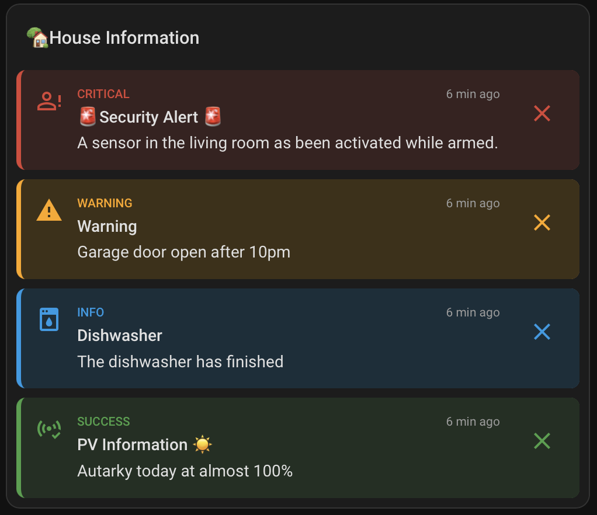
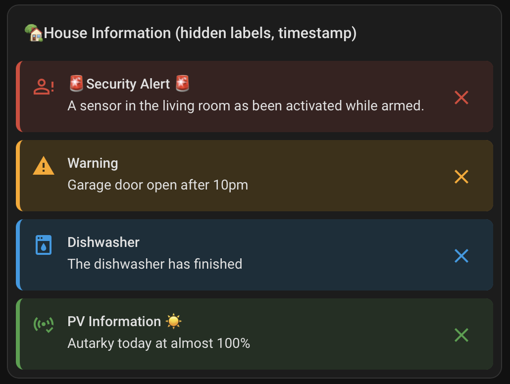
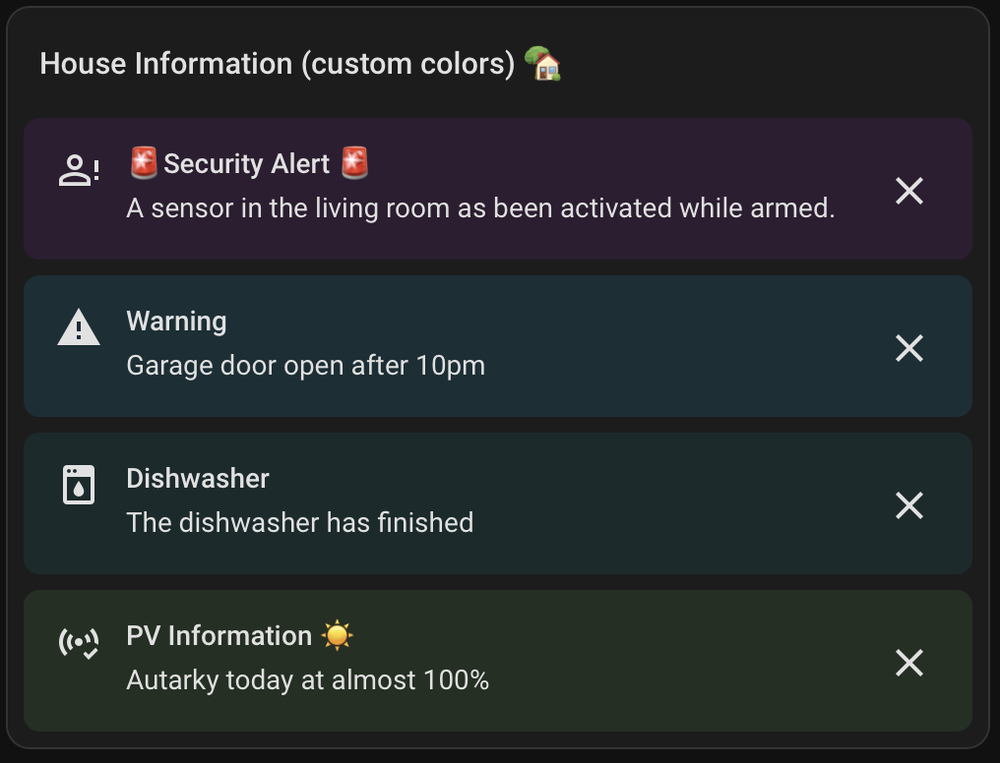
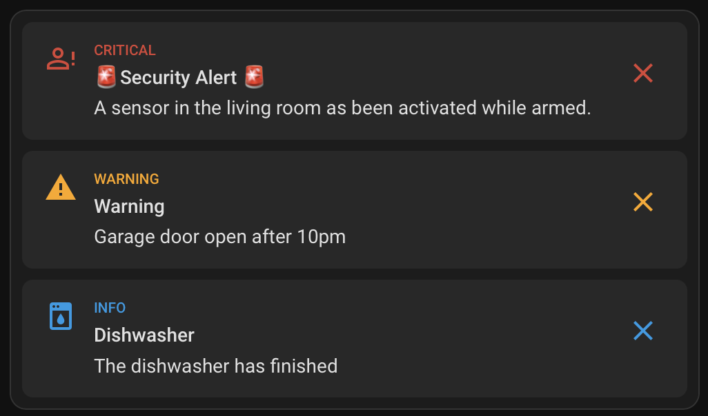
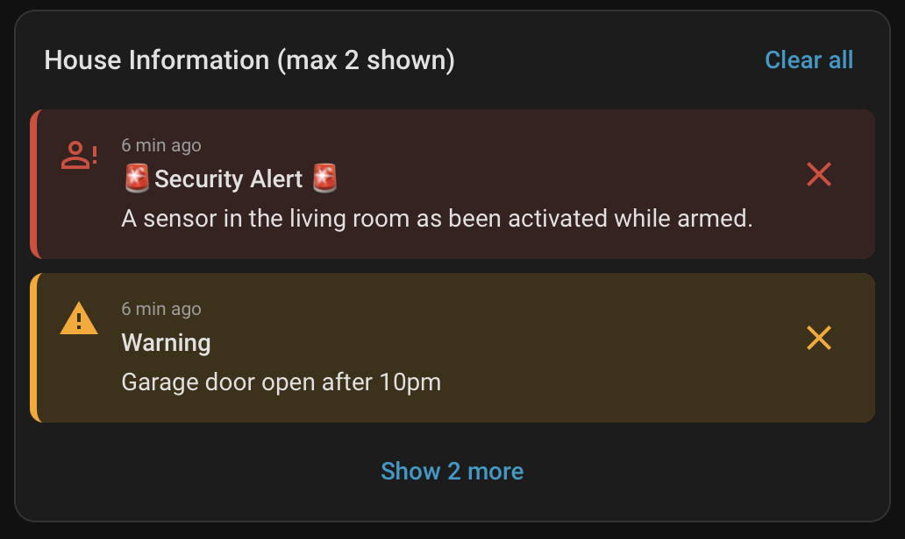
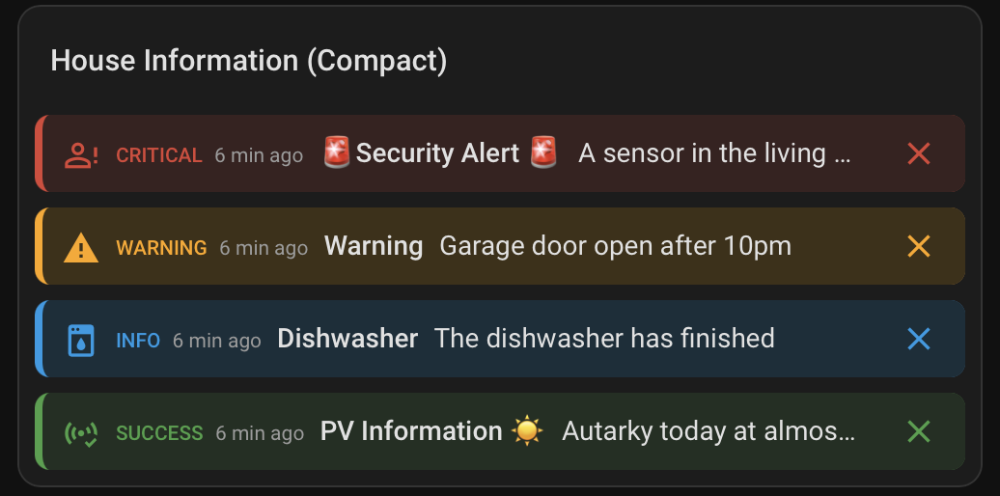
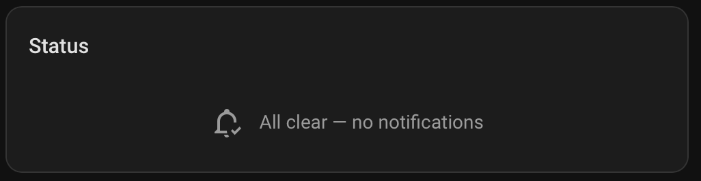
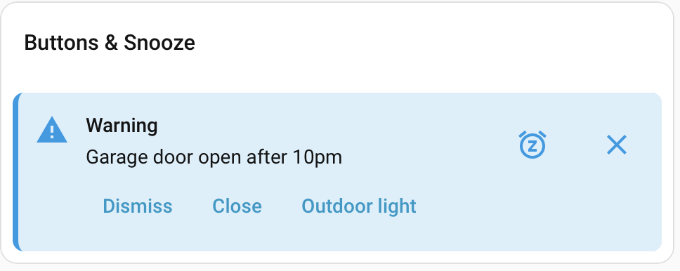

# Card

The card `custom:heads-up-card` shows the messages that have the `banner` channel, made with `heads_up.notify` or `heads_up.create_banner`. It is registered when the integration loads. You do not add a dashboard resource.

Add it in the dashboard YAML editor:

```yaml
type: custom:heads-up-card
```

The card shows a banner while it is active, not dismissed by you, and not removed by timeout, condition or `clear_banner`. Changes appear in an open dashboard without a reload. The card has a visual editor with every option below.

## Options

| Option | Type | Default | Meaning |
|---|---|---|---|
| `severity` | list of `critical`, `warning`, `info`, `success` | all | Show only these severities. A single string is accepted. |
| `tag` | list of strings | all | Show only banners with one of these tags. A single string is accepted. |
| `max_items` | integer, 1 or more | no limit | Show at most this many banners, after sorting. Banners beyond the limit are never shown. |
| `collapsed_items` | integer, 1 or more | off | Show this many banners and a "Show N more" button for the rest. The button then reads "Show less". |
| `sort` | `severity` or `time` | `severity` | `severity`: critical first, then warning, info, success; newest first within a severity. `time`: newest first. |
| `layout` | `comfortable` or `compact` | `comfortable` | `compact` puts each banner on one line. |
| `title` | text | none | A header above the banners. |
| `show_time` | boolean | `false` | Show how long ago the banner was created or replaced ("just now", "50 min ago", "3 h ago", "1 day ago", "2 days ago"). |
| `show_severity` | boolean | `false` | Show the text label ("Warning"). Without it, the icon and color show the severity. |
| `colorize` | `all`, `background`, `icon`, `bar` | `all` | Which parts take the severity color: background, icon and left bar; background only; icon and label only; left bar only. |
| `colors` | map of severity to color | theme colors | CSS color or theme variable per severity, for example `critical: "#c62828"` or `info: var(--primary-color)`. |
| `clear_all` | boolean | `false` | Show a "Clear all" button in the header. |
| `swipe_to_dismiss` | boolean | `false` | Swipe a banner sideways to dismiss it. |
| `show_snoozed` | boolean | `false` | List your snoozed banners under the card with a Show now button. |
| `show_acknowledged` | boolean | `true` | Show the line "Acknowledged by Anna" under a banner that someone acknowledged. `false` hides the line; the Acknowledge button stays. |
| `show_all` | boolean | `false` | Administrators only: also show banners that are targeted at other people. Ignored for other users. |
| `show_empty` | boolean | `false` | Show an empty card when there are no banners. |
| `empty_message` | text | none | Show this text with an icon when there are no banners. Setting it shows the card, also without `show_empty`. |
| `empty_icon` | icon | `mdi:bell-check-outline` | Icon next to `empty_message`. |

An invalid value makes Home Assistant show a configuration error for the card with the reason.

Example:

```yaml
type: custom:heads-up-card
title: Notices
layout: compact
show_time: true
collapsed_items: 3
clear_all: true
swipe_to_dismiss: true
empty_message: All clear
```

## Looks



The card above uses `show_time: true` and `show_severity: true`. The variants below change one thing each.

### Without severity label and time

This is the default. The icon and color show the severity.

```yaml
type: custom:heads-up-card
title: House Information
```



### Custom colors

`colors` sets a color per severity. `colorize: background` colors only the banner background.

```yaml
type: custom:heads-up-card
title: House Information (custom colors)
colorize: background
colors:
  critical: "#2d1f33"
  warning: "#1d2d33"
  info: "#1c2b2b"
  success: "#243021"
```



### Only the icon colored

`colorize: icon` leaves the background neutral. `max_items: 3` hides the fourth banner.

```yaml
type: custom:heads-up-card
colorize: icon
show_severity: true
max_items: 3
```



### Collapsed list

`collapsed_items: 2` shows two banners and a "Show 2 more" button. `clear_all` adds a "Clear all" button that dismisses the banners for you only.

```yaml
type: custom:heads-up-card
title: House Information (max 2 shown)
show_time: true
collapsed_items: 2
clear_all: true
```



### Compact

`layout: compact` puts each banner on one line and cuts long text with "…".

```yaml
type: custom:heads-up-card
title: House Information (Compact)
layout: compact
show_time: true
show_severity: true
```



### Empty

With `empty_message` the card stays visible when there are no banners. Without it, the card hides itself.

```yaml
type: custom:heads-up-card
title: Status
empty_message: All clear — no notifications
```



### Buttons and snooze



A banner with `snoozable: true` and up to 3 `actions` shows a snooze button and text buttons. See [Snooze and buttons](#snooze-and-buttons) and [Buttons and snooze](actions.md#buttons-and-snooze).

## What a banner shows

- An icon, the title (if set) and the message. The severity is shown by the icon and its color; `show_severity: true` adds the text label. When the label is hidden, screen readers still get it.
- With `show_time`, the time since the banner was created or replaced. It updates every 30 seconds.
- A dismiss button (48×48 px) when the banner is dismissible. What it does depends on `dismiss_scope` (see [Actions](actions.md#what-people-can-do-with-it)).
- For administrators, a "Clear for everyone" button on banners that are not dismissible. Banners from [watch rules](rules.md) have none; disable or delete the rule.
- When some banners in a card have a button and others do not, the others keep an empty space of the same width, so the text and times line up.

Critical banners sit in an `aria-live="assertive"` region, the others in a `polite` one.

In the compact layout, a long title or message is cut with "…" and the full text appears as a tooltip. A banner with a `tap_action` keeps its tap action; there is no tap to expand.

## Colors

`colors` takes any CSS color (`#c62828`, `teal`, `rgb(…)`) or a theme variable (`var(--primary-color)`) for each of `critical`, `warning`, `info` and `success`. Severities you leave out use the theme colors `--error-color`, `--warning-color`, `--info-color` and `--success-color`. A value the browser does not accept as a color falls back to the theme color. The card does not check contrast: choose colors that stay readable in your light and dark themes.

With `colorize: background` the icon and label use the theme text colors; with `colorize: icon` the background is the theme's secondary background and the left bar is not drawn.

## Clear all

The button dismisses every dismissible banner that the card shows, including banners behind "Show more", for you only. It does not remove banners for other users, except banners with `dismiss_scope: global`, which a dismissal removes for everyone, as the X button does. Banners with `dismissible: false` stay. The button appears only while at least one banner can be dismissed.

A dismissal belongs to the user, not to the card: a banner you dismiss disappears from every Heads Up card you see.

## Swipe to dismiss

Drag a dismissible banner sideways, left or right, by at least 80 px or 30% of its width. The banner slides out and is dismissed. A shorter drag snaps back. A swipe does not run the tap action. The X button stays. On a snoozable banner, a right swipe opens the snooze choices instead; see [Snooze and buttons](#snooze-and-buttons).

Tested with a mouse drag in a desktop browser. Touch screens are not tested; the card tells the browser to keep vertical scrolling for itself (`touch-action: pan-y`).

## Snooze and buttons

A banner created with `snoozable: true` shows a snooze button (an alarm icon) next to the X. Pressing it opens a row of choices under the banner, for example "15 min", "1 h", "4 h". Pick one and the banner disappears for that time and then comes back. Escape closes the row. With `snooze_scope: user` (the default) it disappears only for you; with `global` for everyone. A banner that is not dismissible is never snoozable.

With `swipe_to_dismiss: true`, swiping a snoozable banner to the right opens the same row of choices; swiping left dismisses it. On other banners both directions dismiss.

With `show_snoozed: true`, a "Snoozed (2)" button appears under the card whenever you have snoozed banners. It opens a list with the time left ("back in 12 min") and a **Show now** button per banner that ends the snooze at once. A snooze with `snooze_scope: global` ends for everyone. The card shows even when all its banners are snoozed. It follows the `severity` and `tag` filters.

A banner with `actions` shows up to 3 text buttons under its message. A button fires the event `heads_up_banner_action`, can close the banner for you (`dismiss: true`) and can run a Home Assistant action, the same way a `tap_action` does. The compact layout shows no buttons. See [actions](actions.md) for the fields.

Tested with a mouse in a desktop browser on Home Assistant 2026.9.4. Touch, keyboard use of the snooze row and phone width are not tested.

## Acknowledge

When an escalation or reminder policy applies to a banner ([Policies](policies.md)) and nobody has acknowledged it, the banner has an **Acknowledge** button next to its own buttons. Pressing it stops the escalations and reminders of that message for everyone. The banner stays on the dashboard and the button goes away. The compact layout shows no buttons, so it has no Acknowledge button; it still shows the line.

A banner that someone acknowledged shows a line under its text: "Acknowledged by Anna", "Acknowledged by Anna and 1 other" or "Acknowledged by Anna and 2 others". The name is the first word of the person's name; the first person is the one who acknowledged first. Someone without a person entity is counted but not named, and a banner acknowledged only by such a person shows "Acknowledged". The option `show_acknowledged: false` hides the line. Watch rule banners work the same, if a policy applies to the tag `rule`. The acknowledgement ends when the banner's condition turns false (rules) or when its severity changes.

## Empty card

With no banner to show, the card does one of three things:

- With `empty_message`: it shows the icon and the text, centered. With `title`, the header stays.
- With `show_empty: true` and no message: it shows an empty card.
- Otherwise it hides itself. On Home Assistant 2026.9.4 in a sections view, the cards above and below then sit at the usual distance and no gap remains.

## Image

A banner with an `image` shows the picture under its message, up to 180 px high. Paths under `/api/` and `/media/` are signed for you; `/local/` paths and external URLs are used as written. A picture that does not load is left out. The compact layout shows no picture. See [actions](actions.md) for the field.

## Tap action

A banner with a `tap_action` is a button. Tapping it passes the action to Home Assistant, which runs it. Tested: `navigate` and `perform-action`, both with `confirmation`. Add a `confirmation` to the tap action to show a dialog first. Any user who can see the banner can run its tap action; see [SECURITY.md](../SECURITY.md).

## Connection loss and restarts

When Home Assistant restarts, the card reconnects by itself. It shows "Heads Up is not available" until the integration has loaded, retries after 1, 2, 5 and 10 seconds and then every 30 seconds, and shows the banners again without a page reload.

## Not supported

- Banner text is shown as written; it is not translated. The card's own labels follow the language of your Home Assistant user: English, German, French or Spanish; other languages show English.
- There is no per-card setting for the dismiss behaviour: it comes from the banner.
