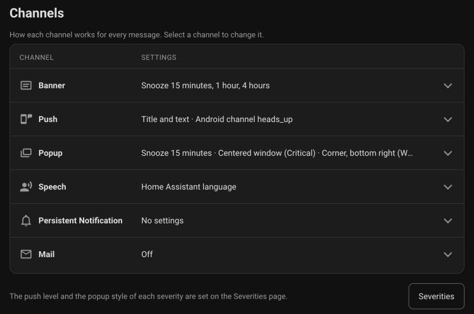
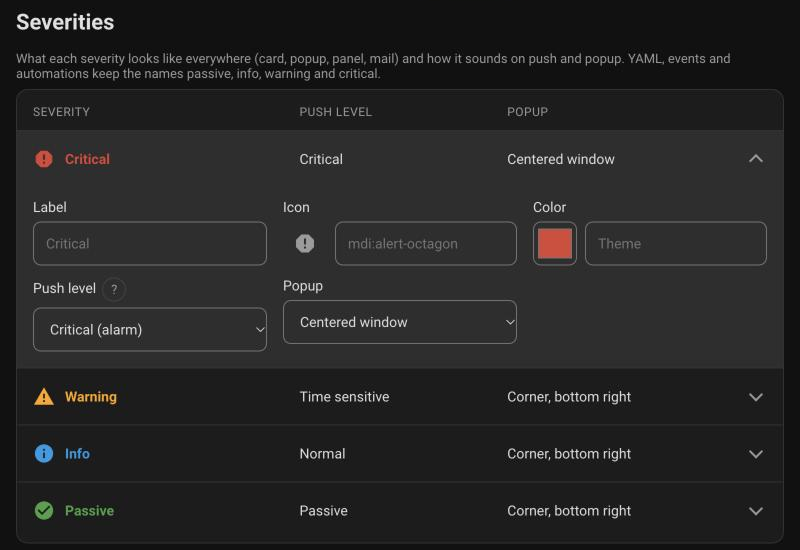
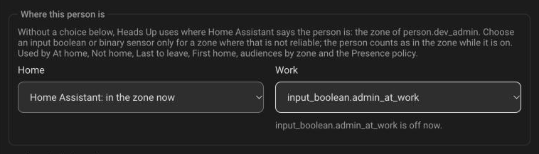
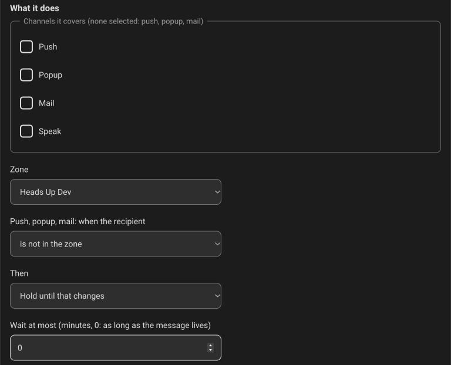

# Configuration: channels, audiences, recipients and policies

These are the hub objects and the channel settings. A call says what to send (see [Actions](actions.md)); this page says who is reached, how each channel behaves and which policies shape the delivery.

Create and edit them in the panel (Configuration group: Channels, Audiences, Recipients, Policies, Severities) or under Settings > Devices & services > Heads Up (Add entry, pencil to edit). Both save to the same entries, so a change in one shows in the other. Each panel editor shows the stored data as YAML and a list of problems; Save is disabled while there are problems. An audience or speaker group that a policy uses cannot be deleted in the panel: the Delete button is disabled and the page names the policies. Home Assistant's own screen does not enforce this. If it is deleted there, the policy cannot run, the Message Log shows `audience_missing` or `group_missing`, and Needs attention on the Overview reports the policy.

## Channels

The panel's Channels page lists banner, push, popup, speech, Persistent Notification, mail and inbox with a summary of their settings; select a channel to change it. The Persistent Notification and Inbox rows only say that the channel has no settings.



A call names its channels in `channels`. Push, popup, mail and inbox take `recipients` or `audience`, speech takes `speakers`. The banner takes `recipients` or `audience` too, or shows to everyone without them. The Persistent Notification takes no target.

| Channel | Target in `notify` | Shortcut action |
|---|---|---|
| `banner` | none, or `recipients`/`audience` to limit who sees it | `create_banner` |
| `push` | `audience` or `recipients` (persons, phones) | `push` |
| `popup` | `audience` or `recipients` (persons) | `popup` |
| `speak` | `speakers` (speakers, Assist satellites, groups, areas) | `speak` |
| `mail` | `audience` or `recipients` (persons, `Global address`) | none |
| `persistent` | none | none |

The panel's Channels page sets the options below, except the push level and the popup style of each severity, which are on the Severities page. They are stored in the integration options; [Settings](settings.md) lists every option with its default.

| Option | Default | Meaning |
|---|---|---|
| `severity_display` | none | Label, icon and color per severity, set on the Severities page. See Severities below. |
| `push_levels` | passive `passive`, info `normal`, warning `time-sensitive`, critical `critical` | Push level per severity, set on the Severities page. |
| `push_lockscreen` | `full` | `full` shows title and text. `title_only` shows the title and a fixed line. `generic` shows "Heads Up" and a fixed line. |
| `push_channel_id` | `heads_up` | Prefix of the Android notification channel. |
| `push_sticky` | off | Keeps the notification after a tap (Android). |
| `push_severity_look` | off | On: a push without its own `icon` or `color` uses those of its severity. Off: only the `icon` and `color` of the message. |
| `push_progress_interval` | 5 | The least seconds between two pushes of a message with a progress bar, 1 to 300. `progress.interval` of a message overrides it. |
| `popup_styles` | corner card (bottom right) for passive, info and warning, centered window for critical | Per severity: `card` (bottom right), `card_bottom_left`, `card_top_right`, `card_top_left`, `modal` (centered window) or `off`. The Channels page words them as the corner or the centered window. |
| `speak_language` | the Home Assistant language | Language of the spoken text. The Channels page offers the languages of the text-to-speech engine that speech uses; without a chosen or single engine you type a code such as `en-US`. Assist satellites speak in the language of their own voice assistant. |
| `mail_service`, `mail_global_address`, `mail_subject`, `mail_body` | none, none, `{severity}: {title}`, `{message}` | The mail channel, see Mail below. |

### Push

The push channel sends a message to the Home Assistant Companion app on the phones and tablets of the people you target. It calls the services `notify.mobile_app_<device name>`, not the notify entities, because only the services pass `tag`, `actions` and `clear_notification` on to the app.

```yaml
action: heads_up.notify
data:
  id: garage_open
  title: Garage
  message: The garage door has been open for 10 minutes.
  severity: warning
  channels: [push]
  audience: binary_sensor.heads_up_audience_at_home
```

Every device of a person gets the notification. A person with no usable device, a device whose notify service does not exist and a profile that does not accept push are skipped, and the Message Log says why (`no_usable_device`, `service_not_found`, `channel_not_accepted`). The response counts of `notify` come from the plan made before sending: `sent` means the notification was handed to the app's service. A service that then fails shows as a failed delivery in the Message Log.

| Part | Value |
|---|---|
| Title and text | The message's `title` and `message`. |
| `tag` | `hu-<install token>-<message id>`. A new notification with the same tag replaces the old one on the device. |
| `group` | `hu-<install token>`. |
| Level | By severity: `passive` passive, `info` normal, `warning` time-sensitive, `critical` critical; change them on the Severities page. Passive is `importance: low`, normal `default`, time-sensitive `high`, critical `max`. |
| Android delivery | For time-sensitive and critical: `priority: high` and `ttl: 0`, so an idle phone shows the notification at once. |
| Android channel | `heads_up_<level>`; the level critical uses the channel `alarm_stream`, which plays from the alarm stream. Android keeps the importance a channel had when it was first used. |
| Tap | A `navigate` tap action opens its `navigation_path`, a `url` tap action its `url_path`. |
| Image | The message's `image` as `data.image`. Left out when the lock screen setting is not `full` (`image_hidden`). Camera proxy paths work on Android only. |
| Status bar icon | The message's `icon`, else the icon of its severity when `push_severity_look` is on, as `data.notification_icon`. On Android it is the status bar icon. On iOS it is the sender icon, which needs a title: a message without one is sent with the title `Heads Up`. |
| Color | The message's `color`, else a `#rrggbb` color of its severity from the Severities page, as `data.color`. Android colors the notification; iOS uses it as the background of the icon. |
| Sender icon | The message's `icon_url` as `data.icon_url`. Left out when the lock screen setting is not `full` (`icon_url_hidden`). |
| Subtitle | The message's `subtitle` as `data.subtitle` on iOS and `data.subject` on Android. Left out when the lock screen setting is not `full` (`subtitle_hidden`). |
| Progress | The message's `progress` as `data.live_update: true`, `data.progress` (percent) and `data.progress_max: 100`, with the same tag so each update replaces the notification. A message without a title is sent with the title `Heads Up`. Android also gets `alert_once`. Updates are sent at most every `push_progress_interval` seconds (default 5), the final value always, and the push limits per minute do not apply to them. Only the push channel repeats a progress update; speech, popup and mail do not. |
| Buttons | The message's own `actions`, then Snooze when the message is snoozable, then Dismiss when it is dismissible. Android shows at most 3 buttons and iOS 10. Extra buttons are left out (`buttons_clipped:<n>`): Acknowledge and Dismiss are kept first, then the message's own buttons in order, and Snooze goes first. |

The level critical is an alarm on both platforms. On iOS it is the critical alert: it needs the app's permission, plays a sound regardless of silent mode and cannot be replaced, so the hub clears it and sends a new one on an update. On Android it uses the alarm channel, so it sounds in vibrate and silent mode. Do Not Disturb is overridden only if you allow it for that channel in the Android settings.

A message that ends (cleared, expired, condition false, dismissed for everyone, evicted) is removed from every device. Heads Up asks the app to remove it (`clear_notification` with the tag), and the Message Log shows a `cleared` row per device when it did. Whether the phone then removes it is up to the app: the Companion app documents that iOS, and Android for notifications that are not critical, may need the app to have been used recently for a clear to work, and that on iOS only the most recent critical notification per tag is cleared. The documentation says nothing about macOS. A user who dismisses or snoozes the banner loses only their own notification, and when a snooze ends that user is notified again. Swiping a notification away changes nothing. An update to a message replaces the notification in place.

Pressing Acknowledge, Dismiss, Snooze or one of the message's own buttons does the same as pressing it on the banner, for the person the notification was sent to. Snooze uses one time, the option Snooze time on push and popup (15 minutes by default). The button ID is `hu:<message>:<person>:<action>`. If the event carries a Home Assistant user that is not the person's user, the press is ignored (`user_mismatch`); a press for a message that no longer exists is ignored (`stale_message`). Buttons of other automations are not touched.

Limits: a failed push is not tried again; a push over 5 per device per minute or 60 in total is skipped (`rate_limited`); an update with the same content within 30 seconds is ignored (`duplicate`); critical messages are never held back. The Acknowledge button appears only when an escalation or reminder policy applies. Pushes were tested with a stand-in for the app, not with a real phone.

### Popup

The popup channel shows a message on top of any dashboard, for the people you target. It needs no card: Heads Up adds one small script (under 1 KB) to every page, which loads the popup code only when a popup is due.

```yaml
action: heads_up.notify
data:
  id: garage_open
  title: Garage
  message: The garage door has been open for 10 minutes.
  severity: warning
  channels: [popup]
  audience: binary_sensor.heads_up_audience_at_home
```

A popup goes to persons, by audience or by `recipients`. A person needs a linked Home Assistant user; a person without one is skipped (`no_user`). The popup appears on every dashboard and device where that user has Home Assistant open. Areas are not supported.

- Each severity is shown as a card in one of the four corners (bottom right by default for passive, info and warning), as a centered window over a dimmed page (the default for critical) or not at all. At phone width a card spans the screen and sits at the top or the bottom, as chosen; left and right make no difference there. A quiet message (Quiet hours with the action Send quietly) is always a card.
- An `image` shows under the text, up to 200 px high; a picture that does not load is left out.
- Buttons are at least 48 px high: the message's own, Acknowledge when an escalation or reminder policy applies, Snooze when the message is snoozable, Dismiss when it can be dismissed. A button's `action` is not run by the popup; only `heads_up_banner_action` is fired.
- One popup is shown at a time, highest severity first, then the oldest. The close button and Escape hide the popup on that page only and the popup returns after a reload. Dismiss hides it for you on every device and keeps the message for others. Acknowledge stops escalation and reminders.
- A critical window takes keyboard focus and keeps Tab inside. With reduced motion set in the system, nothing is animated. When the message ends, the popup closes.

Popups need an open Home Assistant page; use push for a closed app. The popup is not shown on the login page,.

### Speech

The speak channel says a message on speakers: media players and Assist satellites. Use `heads_up.notify` with `channels: [speak]` or the `heads_up.speak` shortcut.

```yaml
action: heads_up.speak
data:
  id: garage_open
  message: The garage door has been open for 10 minutes.
  recipients:
    - media_player.kitchen
    - sensor.heads_up_group_ground_floor
```

`recipients` are media players, Assist satellites, speaker groups and areas. A group is written as the entity ID of its sensor. An area is written by its area ID (`living_room`) and needs no group; it stands for the speakers assigned to it. A group or area written as its name fails with the ID to use. Speech has no audience: it goes to speakers, not to people.

The text is `tts_message` if you set it, otherwise the title, otherwise the message. A text longer than 200 characters is cut after the last word that fits and ends with `…` (option Spoken text: longest).

| Speaker | What Heads Up calls |
|---|---|
| Assist satellite | `assist_satellite.announce` |
| Media player that supports announcements | `tts.speak`, which announces; the player lowers or pauses what it plays and continues afterwards, if the player does that |
| Other media player | `media_player.play_media` with the text-to-speech media source, as plain playback |

- `volume` (0 to 1) sets the volume of a media player before it speaks. A player that cannot set its volume, and an Assist satellite, speaks at its own volume. Heads Up never restores the volume afterwards.
- The text-to-speech engine is the option Text-to-speech engine. If it is empty and exactly one `tts` entity exists, that one is used. With several or none, speech to media players fails with `no_tts_engine`. Overview > Needs attention shows this as an error while a speaker group has a media player, and the Welcome asks for the engine when there are several.
- Without `volume`, Heads Up does not change a volume. What happens to music after an announcement depends on the player.
- A speaker says one message at a time. The same text at the same volume is not said again on the same speaker within 60 seconds (option Spoken text: repeat pause, 0 for no pause; the Message Log shows `cooldown`). Critical messages and messages from Test send ignore this pause. An update does not say a message again (`already_spoken`).
- Speech cannot be taken back. A Quiet hours policy with the action Send quietly skips speech (`quiet_hours`).
- An area or group with no speaker, and a speaker that no longer exists, also leave one entry in the notification bell ("Heads Up: no speaker" or "Heads Up: speaker not found"). It names the area, group or speaker and never the message, because every user sees the bell.
- A missing speaker, a missing service and a missing engine are failed deliveries (`entity_missing`, `service_not_found`, `send_failed`, `no_tts_engine`) and write a log warning, at most one per speaker per hour. Skips are written at debug level. Test send shows each result with its reason.

There is no all-clear announcement and no volume restore. Rooms are Home Assistant areas and their assigned speakers; occupancy is not used.

### Persistent Notification

The persistent channel shows a message in Home Assistant's notification list, the bell in the sidebar. Use `heads_up.notify` with `channels: [persistent]`.

```yaml
action: heads_up.notify
data:
  id: backup_failed
  title: Backup
  message: The nightly backup failed.
  severity: warning
  channels: [banner, persistent]
```

Everyone who uses Home Assistant sees the entry: the bell has one list for all users. Use push or popups to reach single people.

- One entry per message, with the id `hu_<message id>`. An update replaces the entry.
- When the message ends, the entry is dismissed. A dismissal or snooze by one user changes nothing, because the bell is shared.
- Home Assistant empties the bell on a restart. At startup Heads Up creates the entry again for every message that is still active, with the same id, and dismisses entries whose message ended meanwhile.
- Dismissing the entry in the bell is not reported back to Heads Up. The message stays; a later update creates the entry again.
- A missing `persistent_notification` service or a failing call is a failed delivery (`service_not_found`, `send_failed`).
- No per-user entries, no buttons, no Acknowledge or Snooze. A rule message reaches the bell only through an escalation or fallback policy.

### Mail

The mail channel calls a Home Assistant notify service once per recipient, with a subject and a body. Use `heads_up.notify` with `channels: [mail]`. It works with any notify service that takes `title`, `message` and `target`, for example the SMTP integration. Heads Up does not send e-mail itself, so mail does not work until a mail notify service exists.

```yaml
action: heads_up.notify
data:
  id: water_leak
  title: Water leak
  message: The basement sensor is wet.
  severity: critical
  channels: [push, mail]
  audience: binary_sensor.heads_up_audience_admins
        - Global address
```

Set it up:

1. Add the SMTP integration under Settings > Devices & services. It asks for the server, port, connection security, sender, user name and password, and creates a notify service named after the entry.
2. Open the panel, Configuration, Channels, section Mail, and choose that notify service. Without one, mail fails with `no_mail_service`.
3. Optional: enter a Global address.
4. Open Recipients. For each person who gets mail, switch Mail on and enter the person's mail address.

Mail is off for everyone until step 4, so an audience such as Everyone reaches only the persons who opted in.

| Recipient | What happens |
|---|---|
| A person with Mail on and an address | One call of the notify service with `target: [address]`. |
| A person with Mail on and no address | Fails with `no_mail_address` and a log warning. The Global address is not used instead. |
| A person with Mail off | Skipped with `channel_not_accepted`. |
| `Global address` | One call with the Global address as the target. Fails with `no_mail_address` while the setting is empty. Audiences never include it; name it in `recipients`. |

Subject and body are placeholder texts, not Home Assistant templates. The defaults are subject `{severity}: {title}` and body `{message}`.

| Placeholder | Value |
|---|---|
| `{severity}` | The severity as a word in your Home Assistant language, for example Critical. |
| `{title}` | The title, or the message when there is no title. |
| `{message}` | The message. |
| `{person}` | The person's name (the friendly name of the person entity); empty for the Global address. |
| `{person_id}` | The part of the person's entity ID after `person.`, for example `philip` for `person.philip`. It is lower case and has no spaces, whatever the friendly name says; empty for the Global address. |
| `{id}` | The message id. |
| `{tag}` | The tag; empty when there is none. |

Any other `{name}` is refused when you save. A subject has at most 200 characters, a body at most 2000. The notify service receives the subject as `title` and the body as `message`. For a shared mailbox that tells recipients apart by subject, give every person the mailbox as their address and set the subject to `{person}`.

A single message can use its own subject and body with the `mail_subject` and `mail_body` fields of [`heads_up.notify`](actions.md#mail-text-of-this-message). They replace these two texts for that message only.

A mail cannot be taken back: clearing, dismissing or ending the message sends nothing and removes nothing. An update does not send the mail again (`already_sent`). Speech cooldown and buttons do not apply; images and buttons are not sent. A failed call or a missing address fires `heads_up_delivery_failed` (see [Actions](actions.md#events)). A Quiet hours policy with the action Drop or Wait applies to mail.

Delivery is the notify service's job: Heads Up knows only whether the call returned an error. After a mail went through the SMTP integration's notify service, the SMTP integration raises a repair that the service is deprecated and due to be removed in Home Assistant 2027.3. Mail was not tested with a real mail server.

### Inbox

The inbox channel keeps a copy of a message for each person it reaches. The copy is an item: title, text, severity, time, the channels that delivered it and a short timeline. Items are stored, so they survive a restart. Use `heads_up.notify` with `channels: [inbox]` and `recipients` or `audience`.

```yaml
action: heads_up.notify
data:
  id: washer_done
  title: Washing machine
  message: The washing machine is done.
  severity: info
  channels: [inbox]
  recipients: [person.anna]
```

The person needs no phone and no Home Assistant user. A person's recipient profile can switch the inbox off; then the item is skipped for them (`channel_not_accepted`).

- One item per message and person. The same message again, with the same text, adds nothing. New text or a higher severity updates the item and marks it unread.
- A reminder or an escalation that reaches a person who already has the item adds a timeline entry. It does not make a second item. A reminder marks a read item unread again unless the setting A reminder marks a read item unread again is off (see [Settings](settings.md#inbox)).
- An item is read when the person acknowledges the message or dismisses it for themselves. When the message ends, the item stays and is marked resolved, with the reason (cleared, expired, condition or dismissed). It stays unread until the person reads it.
- A dismissal for everyone resolves every item of the message. A snooze changes nothing.
- When Home Assistant starts, items of messages that are no longer active are marked resolved.
- Items older than the retention (12 months by default, 1 to 36 in Settings) are removed, and a person keeps at most 2000 items, the oldest read and resolved ones first. A person who is removed from Home Assistant loses their items after 5 minutes. Removing the integration deletes them.
- The mirror (Settings, Keep a copy of messages of these severities, empty by default) leaves a copy in the inbox of every person that push, popup, mail or the banner delivered to. A banner counts for the persons it names, or for every person with a Home Assistant user when it names none. Speech and the Persistent Notification are not mirrored.
- A copy is history: it is read when it is made, never counted in the sensor or the card, never needs action, and shows in the view Everything of the card with the channels that delivered it. A held delivery makes its copy when it is sent. A copy is not made for a person who switched the inbox off or whose recipient is disabled.
- If the message also goes to the inbox channel, the real item stays and the copy only adds the channel. A real delivery turns a copy into a real item. When a person is at the limit of 2000 items, copies go first.
- Policies treat the inbox like every other channel. A Quiet hours policy with the action Wait holds it, Drop skips it, and Summarize holds it. To keep the inbox out of Quiet hours or Presence, choose the other channels under Limit to these channels. A Presence policy holds the inbox item of a person who is away and releases it when they arrive, like a push.
- Send quietly changes nothing for the inbox: an item has no sound.
- The inbox has no rate limit and takes no buttons.

The inbox card shows the inbox of the user who is looking at the dashboard. It has no person option: a user sees their own items, an administrator too. A user whose Home Assistant account is not linked to a person sees a short hint instead.

```yaml
type: custom:heads-up-inbox-card
size: medium
design: split
```

| Card option | Type | Default | Meaning |
|---|---|---|---|
| `size` | `small`, `medium` or `large` | `large` | Small is a square tile for a grid of tiles. Medium is a wide card. Large is the list itself. |
| `design` | `number`, `ring` or `mosaic` for small; `tile`, `ring` or `split` for medium | the first of its size | How the count looks. Not for the large list. Number shows the count big. Ring splits it by severity. Mosaic shows the icons of up to four unread items, and +N from five on. Tile and ring show the latest unread title. Split has the buttons Open and Mark all read. |
| `titles_only` | boolean | `false` | `true`: the card never shows the text of a message, only its title. Use it on a screen that others can see. |

- Selecting a tile or a medium card opens the list in a window. The large card is the list.
- The list shows the items that need action first, then the latest change first, grouped by day. The filter switches between All and Unread. Mark all read marks every unread item.
- Expanding a row marks the item read and shows its text, a picture if the message had one, and its timeline. Delete removes the item from your inbox.
- The switch at the top shows Inbox or Everything. Everything adds the copies that the mirror makes (see [Inbox](#inbox)); without the mirror it says how to switch it on.
- A critical item nobody acknowledged is marked Needs action with a symbol and a text, not only a color. An item whose message has ended shows Ended.
- The colors are the theme colors of the severities. The list loads 50 items and offers Show more.
- The card follows the language of your Home Assistant user.

The sensor `sensor.heads_up_inbox_<person>` counts the unread items of one person. Its state is that number, and its attributes are `person`, `needs_action` (open critical items nobody acknowledged) and `unread_critical`. The sensor never holds a title or a text, because every user can read entity states. There is one sensor for each person entity, created when the person appears. It is unavailable while the person is missing, and Heads Up removes it after 5 minutes without the person. If you rename a person's entity ID, the inbox follows to the new ID and the old sensor goes away.

## Severities

The four severities are `passive`, `info`, `warning` and `critical`. Calls, watch rules, policies, events and entity attributes always use these names. A call or a card's YAML may still say `success`, an earlier name: it is read as `passive`. The panel's Severities page lists them in one table with their icon, label, color, push level and popup. Select a severity to change it:

- Label: the word shown instead of the built-in name, in every language. It appears on the card (as the screen-reader label, and visibly with `show_severity`), in the popup, in the mail placeholder `{severity}` and everywhere in the panel. At most 30 characters. Empty: the translated name.
- Icon: an `mdi:` icon used when a message has no `icon` of its own, on the card, the popup and in the panel. Empty: the built-in icon. The page warns when two severities share an icon, because the icon shape is what tells them apart without color.
- Color: picked with the color picker, or typed as a CSS color or a theme variable, for example `#d00000` or `var(--error-color)`, used by every card and the popup. A card that has its own `colors` in its YAML keeps them. Empty: the theme color.
- Push level and popup style, the same options as listed under Channels.



## Audiences

These objects say who a call is for. An audience applies to push, popup, mail and, for who sees it, the banner. Speech takes recipients instead; the Persistent Notification takes no target.

An audience is a named group of people. Every audience is a sensor, and a call names the audience by the entity ID of its sensor: `to: {push: {audience: binary_sensor.heads_up_audience_at_home}}`. The audience editor shows the ID, and a rename does not change it. Membership is worked out when the message is delivered. For the banner channel it is worked out once, when the banner is created.

| Name | Who |
|---|---|
| `Everyone` | Every person. |
| `Admins` | Persons whose Home Assistant user is an administrator. |
| `At home` | Persons whose state is `home`. |
| `Not home` | Persons whose state is anything else, including a zone. |
| `Last to leave` | The person whose departure emptied the house. Nobody while anyone is home. |
| `First home` | The first person home after the house was empty. Nobody while the house is empty. |

The Audiences page lists every audience in a table with who is in it right now and how many messages were sent to it. Select an audience to see its members, the policies that use it, when it was last used and its sensor. A built-in audience has an Enabled checkbox there: one that is switched off is not offered and a call that names it fails with the list of valid names; one that a policy uses cannot be switched off.

A built-in audience can also be edited in place. Under Who it reaches, "Leave out these people" removes named persons from it. At home, Not home, Last to leave and First home also have "Only these persons", which limits them to named persons. What the audience means does not change, and its name stays. Policies, watch rules, actions and the audience sensor use the edit at once. Reset to default removes it. An edited audience carries the badge Edited.

The count goes up once per message, from a call or from a policy, however often that message is escalated, reminded or replaced, and it is kept across restarts. Show in Message Log opens the Message Log with only the messages sent to that audience. The Message Log keeps only recent messages and starts empty after a restart, so it can list fewer messages than the count.

You can add your own audience, either as a fixed list of persons or as a presence: at home, not home, last to leave, first home, in a zone, not in a zone (with a zone). A presence audience can be limited to chosen persons, for example At home for one person only. A limited Last to leave or First home names the person only when that person is also the last to leave or the first home of the whole house; it does not look for the last of the chosen persons. A custom name must differ, ignoring case, from the built-in names and from other audiences. The audience's details list which policies use it.

A person whose state is `unknown`, `unavailable` or who has no usable tracker has unknown presence. Presence audiences include that person for `critical` messages and skip them for lower severities (`presence_unknown`). Last to leave and First home change only after a person has been home or away for the presence delay (option Presence delay, 60 seconds by default, 0 for no delay), so a flapping location fix does not move them. Both are kept across restarts.

## Recipients

Every person has a recipient profile without any setup. Their Companion app devices are found through the person's trackers; trackers from other integrations are ignored. The Recipients page lists each person with the number of phones that can be reached ("1 of 2") and a mark per channel: a tick when the channel works, `!` when it is accepted but cannot work, such as push without a phone or popup without a Home Assistant user. Add a profile entry only to change what was found:

- Receives notifications: on by default. Off, the person gets nothing on any channel: not in an audience, not when a call names them, not for critical messages (`recipient_disabled`). Devices, channels and address stay saved. A banner without a target stays visible on their dashboard; a banner or watch rule that names only switched-off persons is shown to nobody.
- Added devices: a Companion device that was not found, added by name.
- Removed devices: a detected device to leave out; you can bring it back.
- Primary device: listed first. A push still goes to every device of the person.
- Accepted channels: banner, push, popup and inbox by default. A channel you remove is skipped for that person. Mail is off until you add it.
- Mail address: where mail to this person goes.
- Where this person is: by default, where Home Assistant says the person is. For Home that is the person's state `home`; for another zone, the zone the person entity is in. For any zone you can choose an input boolean or binary sensor instead: the person counts as in that zone while it is `on`. Use it when the location comes from a rule of your own, for example a template binary sensor that also checks the alarm. Zones without a choice keep Home Assistant's location. It applies to At home, Not home, Last to leave, First home, audiences by zone and the Presence policy. An unavailable entity counts as unknown presence. In Home Assistant's own form the entity for Home is "Home from" and the others are "Other zones from", one `zone.work: binary_sensor.anna_at_work` per line.



The panel lists each person with a column per channel (Banner, Push, Popup, Mail, Inbox): a tick when the person accepts the channel and it can work, a dash when the profile does not accept it, and a warning mark when it is accepted but cannot work (push without a usable device, popup without a Home Assistant user, mail without an address). Point at the mark for the reason. On a narrow screen the phones and channels are written under the name, for example "Push: !". A person who receives nothing is greyed out with a "disabled" badge. Select a person to open their settings under the row: devices, added and removed devices, the primary device, a missing notify service, the missing Home Assistant user, the mail address, where the person is and the accepted channels. A profile that equals the detected devices is not stored. A person with no usable device is skipped on push (`no_usable_device`). A renamed device keeps working: the service is worked out from the device's current name each time.

Speaker groups are named sets of speakers, Assist satellites and areas for speech. Every group is a sensor, and a call names the group by the entity ID of that sensor, for example `sensor.heads_up_group_ground_floor`. The sensor shows how many speakers reach the group now. The panel lists each group with that ID and the number of speakers; select a group to change it, and Add opens a new group under the list. An area stands for the speakers and satellites assigned to it in Home Assistant, and a call names an area by its area ID.

## Renaming

You can rename a policy, an audience, a speaker group, a watch rule or a person without breaking anything that is running. Heads Up keeps each of them under an ID that a rename does not change, and the name is only what the panel shows.

- A call that names an audience, a policy or a group by its entity ID keeps working. The editor of each shows the ID.
- Watch rules, policy targets, messages that are showing and the timers of running escalations, reminders and summaries keep their policy, audience and group.
- If you change the entity ID of a person, a speaker, a zone or a watched entity in Home Assistant, Heads Up changes its own copies of that ID (audiences, groups, profiles, rules, policy targets, stored messages, templates) and writes one line to the Message Log. A call in your own YAML that names the old ID fails with the valid IDs; change it there.
- Heads Up cannot follow a name that another integration owns. If the notify service that sends mail is renamed, Needs attention names the missing service; choose the new one on the Channels page.

## Policies

A policy adds behaviour to messages without changing the automation that sends them. The types are Summarize, Quiet hours, Presence, Get through, Deliver, Escalation, Reminder and Fallback. Add one with New policy on the panel's Policies page or under Settings > Devices & services > Heads Up > Add policy.

Every policy is also a switch entity. Its attributes show what it does: `type`, `apply`, `severities`, `tags`, `not_tags` and the fields of its type. A row on the Policies page opens the entity ID with a Copy button. A new policy shows the ID it gets when you save.

Renaming a policy changes only its name. Its entity ID, the watch rules that use it, the messages that are running and their escalations, reminders and held summaries stay as they were. Deleting a policy ends its timers. A new policy with the same name is a different policy, and a rule or message that used the deleted one is listed under Needs attention until you choose another.

### How policies work together

Every policy that fits a message acts. There is no order and no mode. The Policies page groups the policies in three tables:

- Keep it calm: Summarize, Quiet hours and Presence decide when a message may reach people. They act on every delivery, also on what the other policies add.
- Always gets through: Get through entries say which messages may still wake whom, despite quiet hours and summaries.
- Make sure it arrives: Deliver, Escalation, Reminder and Fallback decide who else gets a message and how often.

A fourth table, Only when named, lists manual policies. Four rules decide what happens when policies meet:

1. Where two calming policies disagree, the calmer result counts: a summary, then drop, then wait, then send quietly.
2. Escalations and reminders count from when the message was created. Reminders on one channel share the shortest rhythm, and each reminder keeps its own count.
3. A Get through entry keeps the messages it fits out of every summary. Quiet hours do not apply to them for the people the entry covers.
4. Presence is never passed: nothing is spoken into an empty house.

How policies work together opens in a window from the Policies page and is also under Help. It shows each type of policy against every other one, with an example.

### Which messages a policy applies to

A policy attaches to messages automatically or manually, chosen in the editor under Which messages.

- Automatically: a message gets the policy when it fits all of these. An empty list matches everything.
  - Severities and tags: the severity is in the first list and the tag in the second. A message without a tag matches only a policy whose tag list is empty. Messages from watch rules have the tag `rule`.
  - Not for tags: a message with one of these tags never gets the policy, even when the lists above match. The editor warns when Not for repeats a tag from the lists above.
- Manually: the policy has no lists and never attaches by itself. Only a call or a watch rule that names it in the `policy` field gets it. Get through entries can be manual too.

Only if limits a policy, automatic or manual, to the time a condition holds, for example "while `input_boolean.guests` is off". It has the shape of the `condition` of `heads_up.notify`. Heads Up checks it each time the policy would act. When the condition turns false, deliveries the policy holds are released. When it turns true, a Get through entry releases what quiet hours hold for its people and takes its messages out of summaries. If Heads Up cannot read the state, for example because the device is offline, Summarize, Quiet hours and Presence do nothing, and the other types still act.

The `policy` field of `heads_up.notify` names manual policies by the entity ID of their switch: they apply next to every automatic policy that matches. Set `match_policies_automatically: false` to switch the automatic policies off for the call; then no automatic policy acts, Quiet hours, Presence and Get through included. `policy: none` uses no policy at all. A watch rule that names a policy uses only that policy.

A disabled policy is never used. A policy you switch on acts on messages that arrive afterwards. Names must be unique, and `none` is reserved. The form refuses a second automatic policy of the same type with the same lists and time, because it would do the same thing twice.

### Test policies

Test policies on the Policies page opens a window that plays a message through your policies without sending anything. Choose the severity, the tag, where it comes from, the channels and the audience, a time, who is at home and when someone acknowledges. The answer lists, per person and channel, whether the message is sent, sent quietly, held or skipped, and which policy caused it. Below it come the escalations and reminders of the next 24 hours.

The answer uses your policies and audiences as they are now. Only if and Faster while use the current state of their entities.

### Needs attention for policies

The Overview warns before a setup traps a message, and again when it happens:

- An escalation that quiet hours can hold, drop or send quietly, because no Get through entry for everyone covers its messages.
- An escalation whose people a Presence policy can hold. It then reaches nobody, and no Fallback steps in.
- Two Presence policies that hold the same messages while a person is in a zone and while they are not. Those messages never arrive.

### Acknowledging

Acknowledging says that someone has seen a message. It stops every escalation and reminder of that message for everyone. The banner stays on the dashboard.

- On a phone, pushes of a message that has an escalation or reminder policy carry an Acknowledge button.
- On the card and in the popup, an Acknowledge button and the line "Acknowledged by Anna" show it; see [the card](actions.md#acknowledge).
- The acknowledgement stays when the message is updated with the same severity. A new severity starts again. A watch rule message starts again each time its condition turns false and true.
- Home Assistant stores who acknowledged in `acknowledged_by`. No event is fired.

### Channels and recipients from the call

Escalation, Deliver and Fallback add a delivery to a call. Each has two settings, Channels come from and Recipients come from. By default both come from the policy: you list the channels and give the audience or recipients for each. You can take either from the call instead.

| Channels come from | Recipients come from | What the policy sends |
|---|---|---|
| This policy | This policy | The channels you list, to the recipients you give for each. This is the default. |
| The call | This policy | The channels of the call, to other people: the same channels, new recipients. |
| The call, only the channels that reached nobody (Fallback only) | This policy | The channels of the call that reached nobody, to other people. |
| This policy | The call | The channels you list, to the people and speakers the call named: new channels, the same recipients. |

Taking both from the call is refused, because the policy would add nothing. Escalation and Deliver offer three of the four rows: they have no failure to react to, so they do not offer "only the channels that reached nobody".

- When the channels come from the call, the policy has a People target (an audience or persons, used for push, popup and mail) and a Speakers target (used for speech). Give at least one; a kind of channel without a target is skipped.
- When the recipients come from the call, the people are the audience or persons the call gave on push, popup or mail, reused on every new channel that takes people. Speech uses the speakers the call named, or is skipped when it named none. The Persistent Notification needs no target. The banner is never part of these deliveries.

Example: send to At home, and fall back to Everyone when nobody is home. Add a Fallback policy that applies to the tag `home-only`, with Use when "Nobody to notify", Channels come from "The call", and the People target set to the audience Everyone. A call with `channels: [push]`, `to: {push: {audience: binary_sensor.heads_up_audience_at_home}}` and `tag: home-only` then pushes to Everyone when At home is empty.

### Get through

A Get through entry lets the messages it fits past quiet hours and summaries. It sends nothing itself: it only changes how a message arrives for the people who get it anyway. Add a Deliver policy only when the message should also reach people the original message does not name.

| Field | Default | Meaning |
|---|---|---|
| Covers | Everyone it reaches | Everyone the message reaches, or only these. |
| Audiences, People and speakers | none | With Only these: the people of these audiences, and these persons and speakers. |

- Summarize never collects a message that an enabled entry fits, whatever the entry covers.
- Quiet hours do not apply to the people and speakers the entry covers. Everyone else gets the message as quiet hours say. One push can ring for the Admins and stay silent for Anna.
- Several entries add up: each lets its own people through.
- An entry never passes Presence.
- A Quiet hours or Summarize policy with Holds these anyway is not passed by any entry.

Example: wake the Admins for leaks at night. Add a Get through entry for the tag `alarm` that covers only the audience Admins. If the leak automation already pushes to the Admins, that is all. If it only creates a banner, add a Deliver policy for the tag `alarm` with a push to Admins.

### Escalation

If nobody acknowledges within the time, the policy delivers the message on the channels you choose, to the targets you choose for each channel, or on the channels of the call to other people, or on other channels to the people of the call.

| Field | Default | Meaning |
|---|---|---|
| Escalate after (minutes) | 5 | Time from when the message was created. |
| Channels come from | This policy | This policy, or the call. See above. |
| Channels | none | `push`, `popup`, `speak`, `persistent`, `mail`; used when the channels come from the policy. |
| Recipients come from | This policy | This policy, or the call. |
| Targets | none | Per channel an audience or recipients, never both. Speak takes recipients only; a persistent notification takes none. With channels from the call: a People target and a Speakers target. |
| Dismissing counts as acknowledging | off | A dismissal by anyone stops this escalation. |

- The escalation also sends to people who already have the message on that channel: they get a new push.
- Quiet hours and Presence act on the escalation like on any delivery. When they hold, drop or quieten it, or it reaches nobody, Needs attention says so. No Fallback steps in.
- Several escalations form a chain by their times. Each runs on its own timer.
- The time is stored. After a restart, an escalation that came due while Home Assistant was stopped runs once.
- With Only if, an escalation whose condition is false when it comes due waits, and runs when the condition turns true.
- A message that waits for its condition does not start its timer until the condition is true. A message that ends cancels its timers. A new severity restarts the timers with the policies of the new severity.

### Reminder

While nobody acknowledges, the policy repeats the notification.

| Field | Default | Meaning |
|---|---|---|
| Repeat every (minutes) | 30 | Time between repeats. |
| At most this many reminders | 3 | The reminder stops after this many. |
| Channels | all | Limit the repeats to these channels. |
| Faster while | none | An entity and a state, and a shorter time. While the entity has that state, the reminder repeats at the shorter time. One count and one limit cover both. |
| Runs alongside other reminders | off | On: the reminder keeps its own rhythm next to the others. |

- Reminders on the same channel share one rhythm: the shortest of the reminders that act at that moment. Each reminder counts its own repeats, so a slow reminder still has its repeats after a fast one stops.
- A reminder never repeats sooner than its own time after the last repeat on its channels.
- Only people who still have the notification are reminded. Someone who dismissed or snoozed it is left out, and when a snooze ends they are notified again. When nobody is left the reminder stops.
- Reminders also repeat what Deliver, Escalation and Fallback sent. Reminders repeat the push with the same tag, so the phone replaces it.
- With Only if, a reminder whose condition is false skips that repeat and tries again after its time.

### Quiet hours

Between two times of day, or while an entity of your choice is on, deliveries outside the dashboard are held, sent quietly or dropped. The banner on the dashboard is never affected.

| Field | Default | Meaning |
|---|---|---|
| Quiet from, Quiet until | 22:00 to 07:00 | The window, on the clock of the Home Assistant time zone. A window may cross midnight. The two times must differ. |
| Days | every day | The days a window starts on. A window that starts on Friday ends on Saturday morning. |
| Or quiet while this is on | none | A schedule, input boolean or binary sensor. While it is `on`, quiet hours apply and the times and days are not used. A missing or unavailable entity counts as not quiet, so messages go out, and the Overview shows a warning. |
| During quiet hours | Send quietly | Send quietly: a push is passive and without sound, speech is skipped, a popup is a corner card. Wait: hold the delivery until the window ends, then send it once. Drop: do not deliver. |
| Limit to these channels | none selected | Push, popup, speech, Persistent Notification or mail. With none selected the policy covers every channel except the banner. Deliveries on a channel you leave out are not held, quieted or dropped by this policy. |
| Holds these anyway | off | On: no Get through entry lets messages past this policy. |

- Quiet hours apply to every severity. Critical messages get through only with a Get through entry, such as Critical from the introduction.
- The window follows the wall clock. On the day the clocks change it is one hour shorter or longer. A time that does not exist or occurs twice uses its first occurrence.
- Reminders during the window are skipped, not held, whatever the action.
- A held delivery is stored and released once at the end of the window, also after a restart. If the message was cleared, expired or acknowledged meanwhile, or the person dismissed it, nothing is sent and the Message Log says why.
- With an entity, Wait holds the delivery until the entity turns off. A schedule also releases it at its next change (`next_event`). If the entity turned off while Home Assistant was stopped, the held delivery goes out at the next start.
- If several quiet hours policies are in their window, the strictest action applies: Drop, then Wait, then Send quietly.

### Presence

Holds or drops a delivery depending on where people are. Push, popup, mail and inbox are checked for each recipient. Speech is checked for the household.

| Field | Default | Meaning |
|---|---|---|
| Channels it covers | push, popup, mail, inbox | Add Speak for speakers. The banner is never held. |
| Zone | Home | The zone that is checked. If a person's recipient profile names an entity for this zone, that entity counts instead of Home Assistant's location. |
| Push, popup, mail, inbox: when the recipient | is not in the zone | Or: is in the zone. |
| Speech: when … of this audience is in the zone | nobody, everyone | Nobody or somebody, of everyone or of a list of persons. |
| Then | Hold until that changes | Or: Drop. |
| Wait at most (minutes) | 0 | For Hold. 0 means as long as the message lives. |
| When the wait ends | Send anyway | Or: Drop (`max_wait_exceeded`). |

- For push, popup, mail and inbox, Presence checks every recipient: members of an audience and persons the call lists by name.
- Presence applies to every severity. To let critical messages through, leave Critical out of the severities.
- Get through entries never pass Presence. Reminders are not checked.
- Unknown presence is never held: the delivery goes out at once. For speech, people whose presence is unknown do not count.
- A change of presence counts after the presence delay in Settings (60 seconds by default), so a short flip at the zone edge releases nothing. With the delay at 0 it counts at once.
- A released delivery is sent once, and not if the message was cleared, expired or acknowledged meanwhile, or the person dismissed or snoozed it.
- Held deliveries are stored and survive a restart.



Examples: "the recipient is not in Home, hold" sends a message when the person comes home. "The recipient is in Home, hold" sends a shopping list when the person leaves. "Speech, nobody of everyone is in Home, drop" keeps speakers silent in an empty house. Guests: give that last policy the Only if "`input_boolean.guests` is off", and speech goes out while guest mode is on.

### Fallback

If a message reached nobody, the policy delivers somewhere else: on its own channels to its own targets, on the channels of the call to other people, or on other channels to the same people.

| Field | Default | Meaning |
|---|---|---|
| Use when | Nobody to notify | Nobody to notify: the audience resolved to nobody (for example nobody is home). Delivery failed: the person has no usable device or sending failed. Both: either. |
| Channels come from, Channels, Recipients come from, Targets | This policy | As for an escalation, with a fourth choice for the channels: the channels of the call that reached nobody for the reason you chose. "Same recipients" helps only with Delivery failed: when the audience was empty, the same recipients are empty too. |

- A fallback is judged once, after the first delivery of the message. It steps in only when neither the call nor any Deliver policy reached someone.
- A channel with a delivery that was sent or held counts as reached. The banner does not count.
- A summary that reaches nobody gets a fallback too. Escalations, reminders and other fallbacks never start one.
- A fallback is never louder than its message: quiet hours and Presence act on it. A Get through entry that covers the speaker lets it speak at night.
- Messages from watch rules only have the banner channel, so they have no first delivery to fall back from.

### Deliver

A call names the channels of its first delivery. A Deliver policy adds channels and targets to it, at once, for the messages it applies to: its own channels and targets, the channels of the call for other people, or other channels for the people of the call. It is how a critical message reaches phones the moment it appears even when the automation or the watch rule only creates a banner.

- It fires once per message, at its first delivery. An update replaces what it sent, like the call's own deliveries.
- Someone who already has the message on that channel from the call is not notified a second time. Several Deliver policies add up.
- Quiet hours, Presence and Get through act on it like on any delivery.
- A message held for a summary gets no Deliver; the people Deliver would add get the summary instead.
- A watch rule message gets it when the policy applies to the tag `rule`, or when the rule names the policy in its policy field.

### Summarize

A Summarize policy holds the messages it applies to on every channel, including the dashboard banner, and sends one summary instead.

| Field | Default | Meaning |
|---|---|---|
| Summary every (minutes) | 60 | The summary is sent this many minutes after the first message was held. |
| Summary at (time of day) | none | Sends one summary each day at this local time instead of by the interval. |
| Holds these anyway | off | On: Get through entries do not keep messages out of this summary. |

- A message that a Get through entry fits is not held. When an entry starts to fit later, held messages it fits are taken out and delivered as new messages.
- If two Summarize policies fit a message, the one whose summary is due next holds it.
- A held message is not shown on the dashboard, not counted by the active banners sensor and not sent. Administrators with `show_all` still see it. It starts no escalation or reminder.
- The summary is one message for each recipient and channel: the people the held messages would have reached, Deliver's recipients included. It has a count in the title and one line per message, at most ten, then "and N more". Its severity is the highest of the messages.
- A message that was cleared before the summary is listed once, marked resolved. Nothing is sent when nothing was held.
- The summary stays for 24 hours or until it is dismissed. Quiet hours, Presence and Fallback act on it like on any delivery. It is never held, escalated, reminded or summarized itself.
- The messages stay hidden after their summary. A held message that changes its text or severity is listed again in the next summary.
- The hold is decided when the message appears. A policy added later does not hold messages that are already there. Deleting or disabling the policy releases its held messages, which then run as new messages.
- Held messages and the timer are stored and survive a restart. A summary that came due while Home Assistant was stopped is sent once.

### The defaults of the introduction

The introduction offers four items. Create adds only what is missing: a policy with the same name, or one that does the same as a policy you have, is skipped, and nothing you have is changed or deleted.

- Critical messages: the Get through entry Critical (critical messages pass quiet hours and summaries for everyone), Critical delivery (a push to the audience you choose, Admins by default, as an alarm), Critical reminder (every 10 minutes, at most 3 times) and, if you choose speakers, Critical escalation (after 10 minutes on those speakers; dismissing counts as acknowledging).
- Warning reminders: every 30 minutes, at most 3 times.
- Evening summary: messages tagged `digest` are held and sent at 20:00. Your automations have to set the tag.
- Night quiet: from 22:00 to 07:00 pushes go out without sound and speech is skipped, Not for the tag `digest`.

Critical messages covers every critical message, also those of your existing automations. They get an Acknowledge button on the card and in the push. The audience and the speakers are chosen inside the Critical item of the introduction because a policy cannot mean "the people of the original call". Create states how many policies it makes: three for Critical messages, four with speakers, and one for each other item.

### Example

```yaml
action: heads_up.notify
data:
  id: water_leak
  message: Water on the kitchen floor.
  severity: critical
  tag: water
  channels: [banner, push]
  audience: binary_sensor.heads_up_audience_at_home
  policy: switch.heads_up_policy_water_escalation
```
