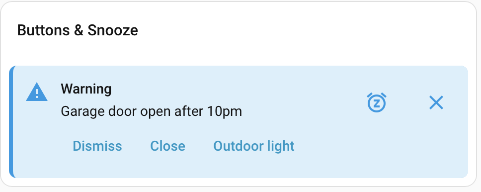

# How to use Heads Up

This page walks through every part of Heads Up with examples: the card, creating banners, buttons and snooze, watch rules and the integration options. Install and set up first, see the [README](../README.md).

## 1. Dashboard card

Add the card to a dashboard in the YAML editor. Without options it shows every banner, most severe first:

```yaml
type: custom:heads-up-card
title: House Information
show_time: true
show_severity: true
```


All options are in [docs/card.md](card.md). The card also has a visual editor. These variants change one thing each.

**Without severity label and time.** This is the default. The icon and color show the severity.

```yaml
type: custom:heads-up-card
title: House Information
```


**Custom colors.** `colors` sets a color per severity. `colorize: background` colors only the banner background.

```yaml
type: custom:heads-up-card
title: House Information (custom colors)
colorize: background
colors:
  critical: "#2d1f33"
  warning: "#1d2d33"
  info: "#1c2b2b"
  success: "#243021"
```


**Only the icon colored.** `colorize: icon` leaves the background neutral. `max_items: 3` hides the fourth banner.

```yaml
type: custom:heads-up-card
colorize: icon
show_severity: true
max_items: 3
```


**Collapsed list.** `collapsed_items: 2` shows two banners and a "Show 2 more" button. `clear_all` adds a "Clear all" button that dismisses the banners for you only.

```yaml
type: custom:heads-up-card
title: House Information (max 2 shown)
show_time: true
collapsed_items: 2
clear_all: true
```


**Compact.** `layout: compact` puts each banner on one line and cuts long text with "…".

```yaml
type: custom:heads-up-card
title: House Information (Compact)
layout: compact
show_time: true
show_severity: true
```


**Empty.** With `empty_message` the card stays visible when there are no banners. Without it, the card hides itself.

```yaml
type: custom:heads-up-card
title: Status
empty_message: All clear — no notifications
```


## 2. Create and clear banners

Run these in Developer tools > Actions (YAML mode) or put them in an automation or script. The banner appears in the card without a reload. Close it with the X button, or remove it with `heads_up.clear_all`. The calls below produce the banners in the first screenshot of section 1.

**Critical.** Sorts first and is never removed to make room for new banners. `timeout: 0` keeps it until someone closes it.

```yaml
action: heads_up.create_banner
data:
  id: security_alert
  title: Security Alert
  message: A sensor in the living room has been activated while armed.
  severity: critical
  icon: mdi:account-alert-outline
  timeout: 0
```

**Warning.** The default severity. Without `timeout`, the banner disappears after 24 hours.

```yaml
action: heads_up.create_banner
data:
  id: garage_open
  title: Warning
  message: Garage door open after 10pm.
  severity: warning
```

**Info.** The icon replaces the default one. The banner disappears after 30 minutes.

```yaml
action: heads_up.create_banner
data:
  title: Dishwasher
  message: The dishwasher has finished.
  severity: info
  icon: mdi:dishwasher
  timeout:
    minutes: 30
```

**Success.** Calling this again with the same `id` replaces the banner instead of adding a second one.

```yaml
action: heads_up.create_banner
data:
  id: pv_status
  title: PV Information
  message: Autarky today at almost 100%.
  severity: success
```

**Tied to an entity.** The banner shows while the entity is `on` and is removed the first time it stops matching.

```yaml
action: heads_up.create_banner
data:
  id: window_bedroom
  message: The bedroom window is open.
  timeout: 0
  condition:
    entity_id: binary_sensor.bedroom_window
    state: "on"
```

**For one person, not closable.** Only the user linked to the person sees it. Nobody can close it. Remove it with `clear_banner`.

```yaml
action: heads_up.create_banner
data:
  id: water_leak
  title: Water leak
  message: Water detected in the basement.
  severity: critical
  dismissible: false
  people:
    - person.alex
```

```yaml
action: heads_up.clear_banner
data:
  id: water_leak
```

**With a tap action.** Tapping the banner opens a dashboard view.

```yaml
action: heads_up.create_banner
data:
  message: Water detected under the dishwasher.
  severity: critical
  tap_action:
    action: navigate
    navigation_path: /lovelace/kitchen
```

More examples, including REST and WebSocket calls, are in [docs/examples.md](examples.md).

## 3. Buttons and snooze



A banner can carry up to 3 text buttons and a snooze button. This call makes the banner above. The first button closes the banner for you; the other two only fire the event.

```yaml
action: heads_up.create_banner
data:
  id: garage_open
  message: Garage door open after 10pm.
  severity: warning
  timeout: 0
  snoozable: true
  snooze_options:
    - minutes: 15
    - hours: 1
    - hours: 4
  actions:
    - key: dismiss
      label: Dismiss
      dismiss: true
    - key: cls
      label: Close
    - key: light
      label: Outdoor light
```

Pressing a button fires the event `heads_up_banner_action` with the banner `id`, the button `key` and the `user_id`. An automation reacts to it:

```yaml
triggers:
  - trigger: event
    event_type: heads_up_banner_action
    event_data:
      id: garage_open
      key: light
actions:
  - action: light.turn_on
    target:
      entity_id: light.outdoor
```

A button can also run a Home Assistant action in the card, like a tap action. Add `action:` to the button, for example `action: {action: navigate, navigation_path: /lovelace/garage}`.

The snooze button opens the choices you gave in `snooze_options` (15 min, 1 h, 4 h here). The banner then hides for that time and returns. `snooze_scope: global` hides it for everyone instead of only you. With `swipe_to_dismiss: true` on the card, a right swipe opens the choices and a left swipe dismisses. With `show_snoozed: true` on the card, a "Snoozed (n)" button lists your snoozed banners with the time left and a **Show now** button that ends the snooze early. Details: [card.md](card.md#snooze-and-buttons) and [actions.md](actions.md#buttons-and-snooze).

## 4. Watch rules

A watch rule shows a banner while an entity matches a condition. It needs no automation and no card setting. Go to Settings > Devices & services > Heads Up and choose "Add watch rule".


Examples, as filled into the form. `{name}` in the message becomes the entity's name. The message may also contain a Home Assistant template such as `{{ states('input_text.reason') }}`; it updates when the entities it reads change (not for `now()`).

| Goal | Entity | Condition | State | Message | Severity |
|---|---|---|---|---|---|
| Window open | `binary_sensor.bedroom_window` | Equals | `on` | `{name} is open.` | warning |
| Door not locked | `lock.front_door` | Does not equal | `locked` | `{name} is not locked.` | critical |
| Room too warm | `sensor.living_room_temperature` | Above | `25` | `The living room is warmer than 25 °C.` | info |
| Battery low | `sensor.phone_battery` | Between | `5` and `15` | `The phone battery is low.` | warning |

Conditions: equals, does not equal, above, below, between, contains text, does not contain text, is empty, is not empty. A rule banner has no close button unless you turn on "Dismissible", and it goes away when the condition is false. The same conditions work in `heads_up.create_banner` through `condition.operator`, and both accept a duration ("for at least 5 minutes"). `create_banner` also accepts a template as its condition. See [docs/rules.md](rules.md) for every field and more examples.

## 5. Integration options

Open the integration and choose Configure. Changes apply to banners created afterwards.

| Option | Default | Meaning |
|---|---|---|
| Maximum number of banners | 50 (1–200) | Limit for stored banners. |
| Evict the oldest lowest-severity banner when full | on | When off, creating a banner beyond the limit fails. `critical` banners are never evicted. |
| Default dismiss scope | `user` | Used when an action sets no `dismiss_scope`. |
| Default timeout | 24 hours | Used when an action sets no `timeout`. Clearing it keeps banners until they are closed or cleared. |
| Banners can be snoozed by default | off | Used when an action sets no `snoozable`. Banners that are not dismissible are never snoozable. |
| Default snooze scope | `user` | Used when an action sets no `snooze_scope`. |
| Default snooze choices | 15 minutes, 1 hour, 4 hours | Used when an action sets no `snooze_options`. Choose from 5 minutes to 24 hours. |

## Reference

| Page | Covers |
|---|---|
| [card.md](card.md) | Every card option, colors, swipe, snooze and buttons in the card. |
| [actions.md](actions.md) | Every field of `create_banner`, `clear_banner`, `clear_all`, conditions, people, errors, events. |
| [rules.md](rules.md) | Every field of a watch rule. |
| [examples.md](examples.md) | More calls, including REST and WebSocket. |
